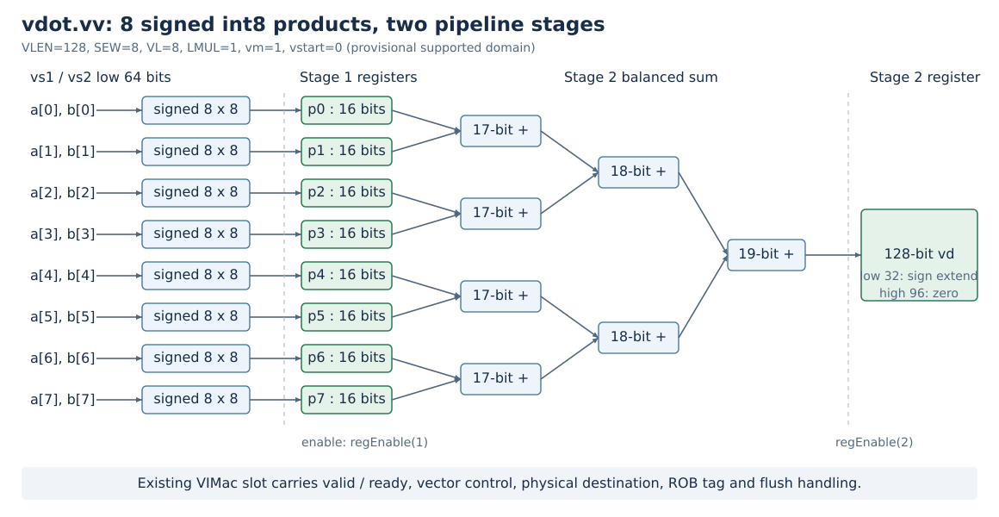

# vdot.vv 设计说明

本文描述交付实现。正式整核、差分与性能结果见FINAL_RESULTS.md；开发期日志另行保留，不替代独立检出的完整验收。

## 1. 平台与语义契约

香山基于官方 `kunminghu-v2` 提交 `7b16188f7f18a97be69c9b1a2dae8a446eec3b47`；向量数据宽度为 128 位。本项目暂定语义见 `contract.json`，尚未得到赛题方确认。

对两个源向量的低 8 个字节分别作有符号解释：

```
s = sum(int8(vs1[i]) * int8(vs2[i]) for i in range(8))
vd[31:0]   = signed32(s)
vd[127:32] = 0
```

源的高 64 位不参与计算；不累加旧目标值。读取源值后才更新目标，目标可与任一源重叠。最小支持域为 `SEW=8, VLEN=128, LMUL=1, vl=8, vstart=0, vm=1`。`vta`、`vma` 不改变上述结果布局，目标的高 96 位总为零。

支持域外的编码形式暂定产生非法指令异常，目标寄存器和 `vstart` 保持原值。向量状态关闭、`vill` 等仍沿用既有向量合法性检查。当前整核差分已验证7种不支持形式及普通非法指令保护检查；独立VS关闭、vill用例尚未单列，不能据此声称全部特权状态组合均已覆盖。

契约v2区分异常来源：后期执行单元配置检查产生cause=2、xtval=0；非零vstart被译码拒绝，xtval为指令位。NEMU通过单次非架构标记对齐该行为，普通非法0x7b仍报告0x7b。目标保持、vstart保留和mtval均由裸机用例断言并经过真实RTL/NEMU比较，详见 `DIFFTEST_CHECKS.md`。

### 宽度选择与量化算子映射

低8项来自赛题语义图。对应对称int8全连接/GEMV时，可沿归约维K作8项分块。以K=128为映射示例：每个输出通道计算16个部分和p[t]=sum(x[8t+i]*W[m,8t+i],i=0..7)，再由调用端以int32跨块求和、加偏置及重量化；非零零点另作修正。[LiteRT量化规范](https://developers.google.com/edge/litert/conversion/tensorflow/quantization/quantization_spec)的全连接输入、权重为int8，偏置为int32，因而32位部分和便于与调用端格式衔接。

在相同全并行乘法/平衡树组织下，4、8、16项分别需要4、8、16路乘法和2、3、4层二元求和。4项要用两条指令覆盖同一个8项块；16项会改变赛题指令定义并增加并行通道。本实现选择8项以满足定义，结果用19位精确求和后扩展到32位。

## 2. 自定义编码

使用 `custom-0` 主操作码。字段布局如下：

| 位段 | 内容 |
|---|---|
| 31:26 | `000000` |
| 25 | `vm`；当前仅接受 1 |
| 24:20 | `vs2` |
| 19:15 | `vs1` |
| 14:12 | `000` |
| 11:7 | `vd` |
| 6:0 | `0001011`（0x0b） |

译码掩码为 `0xfc00707f`，匹配值为 `0x0000000b`。例如 `vd=12, vs1=8, vs2=10, vm=1` 的指令字为 `0x02a4060b`。暂用 `.word` 发射；不依赖编译器认识新助记符。

固定版本的香山实际译码表和NEMU RISC-V译码路径未找到另一条占用此字段模式的已实现指令；Rocket Chip的通用CUSTOM0常量仍存在，它本身不表示被接入香山译码表。译码生成和整核执行均已通过，未穷举全部32位编码空间。

## 3. 向量执行链路接入

- `VecDecoder.scala` 将该编码映射到已有 `FuType.vimac` 调度通路，使用 `VEC_VVV` 拆分形式，并将vdot的第三源显式设为`SrcType.no`，因为结果不读取旧目标值。
- `RiscvInst.scala` 将该编码识别为向量算术指令，使其进入已有向量微操作生成路径。
- `VdotEncoding.op=0x100` 使用 `fuOpType` 高位区分标准向量乘法；固定版本的 `VimacType` 标准操作高两位为零。
- `VIMacU.scala` 内增加 `VdotDatapath`。源值来自 `VecPipedFuncUnit` 的 `vs1`、`vs2`，结果在输出端按操作类型选择。
- `VimacCfg` 原有配置提供 128 位目标数据和两周期执行槽位。写回的物理目标、ROB 标识及向量控制信息沿用其现有通路。

当前方案复用向量乘法单元的调度槽位，并在其包装模块中增加专用算术路径。它会与标准向量乘法竞争该槽位；未为其新增独立发射端口。该限制必须在性能分析中披露。

## 4. 算术与流水

第一阶段并行计算 8 个有符号 8×8 乘积，各保存为 16 位有符号寄存器。第二阶段使用平衡加法树，宽度逐层为 17、18、19 位，最后符号扩展到 32 位并补齐目标向量。

8 项和的实际范围为 `[-130048, 131072]`。19 位有符号表示能够覆盖该范围；采用 16 位累加会在边界测试中溢出。



图中第一组寄存器保存8个16位乘积；第二级组合逻辑依次形成4个17位和、2个18位和、1个19位总和，然后符号扩展低32位、拼接高96位零并寄存。图为结构说明，不表示物理布局或综合时序。

数据寄存器分别受现有 `regEnable(1)`、`regEnable(2)` 控制。有效位、反压、冲刷和目标标识由原有功能单元流水接口处理。独立数据通路测试覆盖独立使能和停顿；整核压力测试已通过不同目的寄存器的8连发、生产者/消费者、16次源目的重叠链和分支目的哨兵检查。具体反压或在途冲刷时序仍需对应事件证据，不由功能通过自动推断。

## 5. NEMU 参考实现

NEMU 基于 `d772a9d9e06f663d529bd1c6518480c1ee59ded2`。在 RISC-V 译码中加入相同编码，执行函数先检查向量配置，再逐项读取两源并以 `int32_t` 累加；全部读取完成后写目标的两个 64 位片段。

低片段赋值为 `(uint32_t)result`，将低 32 位结果保留并使该片段的高 32 位为零；高片段为零。这样负结果也满足“低 32 位补码、高 96 位清零”，且支持目标与源重叠。

独立软件模型位于 `tests/reference.py`。它独立解释打包字节并计算结果；不能用 DUT 输出覆盖 NEMU 结果来取得差分通过。

## 6. 等价向量基线与测量边界

基线以 `vwmul.vv` 得到 16 位有符号乘积，再切换到 SEW=16，以 `vwredsum.vs` 作 32 位扩宽归约。归约目标事先按 SEW=32 清零，使其余 96 位与 vdot 结果布局相同。

原发布基线逐次执行完整的结果布局语义，包含每次清零和配置恢复；当时没有测量跨迭代复用已清零目标等循环优化。本轮另测复用目标及零种子的候选序列、含访存内核，未穷举最优RVV序列；两条基线及实际结果见OPTIMIZATION_RESULTS.md。加速比只相对此处公开的等价序列，不表示相对所有软件实现的最佳加速比。

`workloads/benchmark.c` 当前测量包含必要向量配置、循环控制与末尾结果存储的完整程序片段，并分别运行结果依赖链和无显式结果依赖的循环。该数据不能称为裸功能单元延迟。核心计算区间的周期还需结合实际整核波形或其它可验证边界测量。

性能实验已在关闭波形的RTL运行中执行，采用32、128、512次循环，预热后各重复5次，60样本完整通过。片段加速比2.607–4.634；另有真实波形确认vdot输入至结果2周期。完整边界、基线两个归约微操作及原始日志见 `PERFORMANCE.md`。NEMU计数器和宿主时间只用于功能检查。

## 7. 优化选择和扩展潜力

当前算术路径采用8路并行乘法、三级平衡归约树和乘法/求和两级寄存。与逐项串行累加相比，它在结构上减少了计算的串行步骤；与无寄存的一条组合路径相比，它把乘法与求和分隔开。这些是当前设计选择，具体延迟、吞吐和时序收益仍要由测量确认，平衡树本身不作为原创算法声明。

复用VIMac的操作数、有效位、ROB和目标标识通路，使扩展集中在译码、操作类型和包装器内的算术路径。代价是与已有乘法指令共享发射/写回资源，同时增加专用乘法硬件。未做综合，不能由“复用通路”推断面积开销很小，也不能由流水级数推断整段程序加速比。

原独立检出验收版本保留通用OPIVV的第三源旧vd调度信息，虽然vdot算术不使用旧目标。原有NewDispatch/issue逻辑在满足vta或vlmax等条件时消除该依赖；旧benchmark的vdot循环使用ta/ma。tu配置下可能保留额外等待。本轮本地实现将该指令的src3显式设为SrcType.no，保留两个真实源和向量配置依赖；新全核构建、功能/故障回归及前后540条性能样本已经通过，未以旧版本验收代替新改动验证。512次TU独立寄存器点积由3639降至625周期，改善5.822倍；TA、真实依赖链及含访存中位周期未因本次修改下降。原算术模块与VIMac包装器的生成RTL字节一致，译码差异及完整结果见OPTIMIZATION.md和对应新报告。

后续扩展需要分别处理三个层面：

| 扩展方向 | 数据通路变化 | 还必须改变或验证的契约 |
|---|---|---|
| 更高SEW | N路有符号SEW×SEW乘法，累加位宽至少为2×SEW+ceil(log2(N)) | 结果元素宽度、扩宽写回布局、溢出处理与NEMU参考模型 |
| 更高VLEN或更多输入项 | 增加乘法通道和树层数，或分批累加 | 每条指令的项数、LMUL/微操作拆分、跨批状态、冲刷和退休边界 |
| 更多点积类型 | 按符号类型分别扩展操作数，或增加混合精度模式 | 编码、正负解释、舍入/饱和语义及独立测试 |

当前版本仍固定为8个int8乘积，并未实现上表功能。若把通道数推广为N，累加树层级约为ceil(log2(N))；当树深或乘法宽度增加时，需要重新选择流水级并同步修改功能单元延迟、有效位和结果标签通路。只改变一个常量不能保证更高SEW/VLEN正确接入。上述分析用于说明可扩展边界，避免把未来方向写成已支持能力。

## 8. 验证范围与保留边界

原提交版本的整核定向、完整随机、重叠、目标清零、非法形式、连续突发、依赖和故障注入恢复均已在独立检出完整验收中通过。本轮优化版已在新的独立检出中完成同类功能回归、故障反例与恢复以及完整波形验收，来源绑定实际构建源码4e5cfce。波形另证明3条已写回错路vdot被分支冲刷而未提交，及译码/重命名入口反压；未观察到FU输出端反压或redirect恰在两级算术内部。不能将未观察到的时序计入覆盖，实际来源见FINAL_RESULTS.md。

普通向量乘法在非零 `vstart` 时的行为属于独立探测项。固定 NEMU 原版会主动报非法指令；本项目保留香山普通操作的原有处理，不据此单独判定规范符合性或修改其它向量指令。
