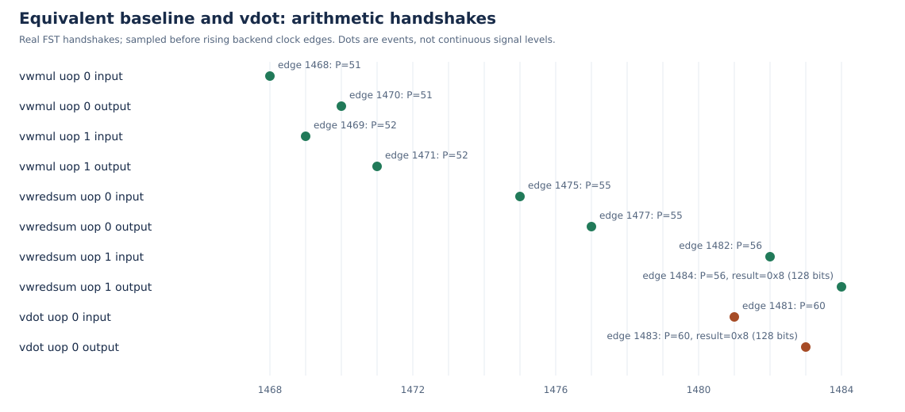

# 实测延迟与程序片段性能

测量日期：2026-11-05。使用与 `STAGE1_WAVEFORM.md` 同一emu和正常NEMU参考库。所有速度数据来自香山RTL，不使用NEMU宿主运行时间、指令数或模拟器速度计算加速比。

## 等价性与测量范围

基线为8个有符号int8扩宽乘法、32位扩宽归约，并事先清零目标的高96位。vdot输出布局与基线一致。两种路径使用相同输入、源/目标寄存器和结果存储位置；`benchmark.c` 为有真实结果依赖和无显式结果依赖分别构造循环。

无显式结果依赖时，vdot仍重复使用逻辑v12，通过重命名消除输出依赖；有依赖时，每次结果v8成为下次的源。测量前预热；每种配置与长度重复5次。区间从序列化的cycle读取到下一次读取，包含必要向量配置、循环控制和最终存储。输入加载在区间外，末尾结果在区间内检查可观察性；这不是完整应用吞吐或裸功能单元延迟。

## 程序片段测量

原始证据：`reports/rtl-benchmark-20261105T013446Z-3572189/`，日志含60条 `BENCH` 样本、`BENCH_PASS` 和GOOD TRAP，退出0。运行未开启波形。中位数和范围由 `scripts/performance_report.py` 从原始日志计算：

可随源码查阅的原始样本副本为 [benchmark-development-20261105.csv](data/benchmark-development-20261105.csv)，来源日志及文件SHA256见 [数据清单](data/development-20261105-manifest.json)。这些是开发目录实测，最终干净复现的数据另行绑定。

| 结果依赖 | 迭代数 | 基线周期中位数（范围） | vdot周期中位数（范围） | 基线/vdot |
|---|---:|---:|---:|---:|
| 无显式结果依赖 | 32 | 473（473–491） | 154（153–187） | 3.071 |
| 无显式结果依赖 | 128 | 1689（1687–1705） | 406（406–423） | 4.160 |
| 无显式结果依赖 | 512 | 6553（6551–6568） | 1414（1413–1430） | 4.634 |
| 有真实结果依赖 | 32 | 730（730–752） | 280（280–302） | 2.607 |
| 有真实结果依赖 | 128 | 2746（2746–2746） | 952（952–952） | 2.884 |
| 有真实结果依赖 | 512 | 10810（10810–10825） | 3656（3640–3657） | 2.957 |

512次时，整片段平均每次为无依赖基线12.799/vdot2.762周期、有依赖基线21.113/vdot7.141周期。这些值包含循环和配置成本，仅代表本程序的摊销成本，不是单元发射间隔。

```bash
bash scripts/run_rtl.sh benchmark
python3 scripts/performance_report.py \
  reports/rtl-benchmark-20261105T013446Z-3572189/run.log \
  --engine rtl --output reports/performance.md
```

## 波形中的计算路径

独立 `latency_probe` 的原始证据：`reports/rtl-latency_probe-20261105T013554Z-3573999/`。FST SHA256为 `8b26c067f6335ff0403e5391507b1153d6989912e4abc7317723237b770a6ec1`。两种路径最终128位结果都为8。边沿编号与阶段一采用相同采样约定，属于这份采集内部序号。

| 指令及微操作 | PC | ROB | P | FU输入边沿 | FU输出边沿 | 此次接口周期 |
|---|---|---|---:|---:|---:|---:|
| vwmul uop0 | 0x800000ba | (0,32) | 51 | 1468 | 1470 | 2 |
| vwmul uop1 | 同上 | 同上 | 52 | 1469 | 1471 | 2 |
| vwredsum uop0 | 0x800000ca | (0,36) | 55 | 1475 | 1477 | 2 |
| vwredsum uop1 | 同上 | 同上 | 56 | 1482 | 1484 | 2 |
| vdot uop0 | 0x800000e2 | (0,42) | 60 | 1481 | 1483 | 2 |

乘法uop0得到8个16位乘积1；uop1对应尾部寄存器，不参与当前VL=8的归约。归约uop0的物理目的55映射内部临时逻辑寄存器32，输出4个32位部分和2；它不是最终结果。uop1的物理目的56映射逻辑v12，输出完整128位8。ROB主提交信息保留P55/逻辑32，因此必须检查同一ROB内两个微操作以及各自重命名，而不能只跟主提交P55。



此次基线从首个乘法输入1468到最终归约输出1484为16周期，包含其间向量配置、清零和依赖调度；vdot从输入1481到结果1483为2周期。两者是一次等价组合路径的对比，不能据此宣称任意程序均为8倍加速。vdot在ROB边沿1502才提交，所含较老指令等待不属于其两周期算术路径。

## 独立突发的接口吞吐

流水压力的补充诊断FST中，实际观察到5组连续8条独立vdot：源为v8至v15与共同的v24，目的为v16至v23。各组输入逐周期握手，输出也逐周期出现，每条输入到结果2周期。第一组如下，边沿编号属于周期14000至27000的诊断窗口内部：

| 逻辑目的 | 物理目的 | 输入边沿 | 输出边沿 | ROB提交边沿 |
|---|---:|---:|---:|---:|
| v16 | 25 | 600 | 602 | 609 |
| v17 | 84 | 601 | 603 | 609 |
| v18 | 85 | 602 | 604 | 609 |
| v19 | 88 | 603 | 605 | 609 |
| v20 | 89 | 604 | 606 | 609 |
| v21 | 90 | 605 | 607 | 609 |
| v22 | 91 | 606 | 608 | 610 |
| v23 | 55 | 607 | 609 | 611 |

分析程序按每条指令的PC、ROB动态区间、物理目的配对，并由实际FU两源的低8个有符号字节独立计算完整128位期望值；40条结果均正确、高96位为零，且找到各自真实提交。完整程序的C黄金模型和NEMU差分另外核对架构结果。可审阅数据为 [burst-throughput-development-20261105.csv](data/burst-throughput-development-20261105.csv)。

因此这些窗口内的实测接收/输出间隔均为1周期，达到1条/周期；这是有限独立突发的接口观测，不代表任意负载的持续吞吐。包括配置和循环的512次无显式依赖片段仍为2.762周期/次，且与标准乘法共享VIMac槽位。诊断采集有意在28000周期截断，不记为完整功能PASS；其输入与单独完整通过的64组压力运行一致，边界见 `VALIDATION.md`。

## 收益、限制与未测项

vdot融合了8路乘法与归约，省去基线的微操作、SEW切换和目标整理。本实现复用VIMac调度及写回槽位，标准向量乘法会与它竞争资源；无依赖循环也包含控制开销，不能据此推断独立端口吞吐上限。

现有数据支持上述裸机程序片段加速，尚不能代表推荐模型或LLM端到端收益。没有综合、时序、面积或功耗测量，不声称频率、面积、功耗或能效收益。当前实现仅支持 `contract.json` 的暂定范围，尚无赛题方语义确认。最终干净检出复现还需重新验证这些结果与最终源码一致。
