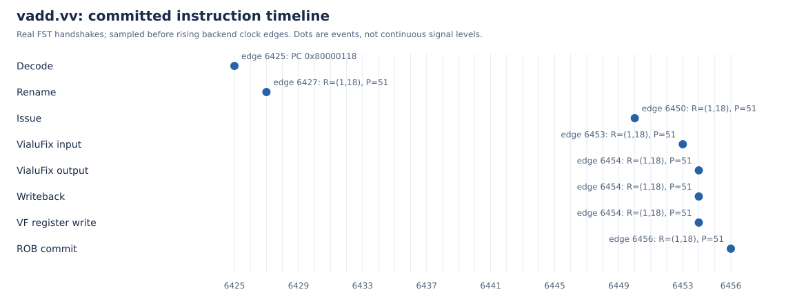

# 阶段一：实际向量加法波形

核对日期：2026-11-05。单核 `MinimalConfig` 保留128位向量单元，关闭性能数据库，启用真实NEMU差分。本文来自实际FST；不以静态源码推导代替波形。

## 运行与输入身份

本机证据目录：`reports/rtl-vadd_test-20261105T013458Z-3573289/`。其中 `command.txt`、`source.json`、`artifacts.sha256`、`time.txt`、`run.log`、`exit-status.txt` 和 `wave.fst` 一起确定此次运行。日志包含 `VADD_PASS`、`Difftest enabled.`、`HIT GOOD TRAP`，进程退出0。

| 对象 | SHA256 |
|---|---|
| emu | `f94a71643146e20148512c41e74bf01654a9ee45b47d6942d01441b5759c77c6` |
| NEMU参考库 | `83fd0337620e0883910b320887c1eb470b18812098259cd2fc498840de5a1e0a` |
| FST | `814558a612886ffd845a8ea3bb73cc61ed114e5c8558e0ef59c0bc218bdb6b92` |

上游固定版本和构建方法见 `BUILDING.md`、`BOOTSTRAP.md`。此次emu复用了早先生成的RTL/C++模型；当前脚本的完整干净检出复现仍须单独完成。普通标准向量指令在带vdot扩展的核上运行，不表述为未修改香山整核的测试。

`vadd_target_pc=0x80000118`，指令字 `0x02850657`，反汇编 `vadd.vv v12,v8,v10`；配置 `VL=16, SEW=8, LMUL=1, vm=1, vstart=0`。RVV文本顺序为 `vd,vs2,vs1`，因此编码中的 `vs1=v10`、`vs2=v8`；执行入口 `src0` 对应v10，`src1`对应v8。预期与实测128位结果均为：

```text
34302c2824201c1814100c080400fcf8
```

## 从提交反向确认同一条动态指令

波形中该PC出现4次译码输入握手：边沿1502、6023、6364、6425。两次重命名分别为6366的 `ROB=(0,6), P=51` 和6427的 `ROB=(1,18), P=51`。只有后者与目标PC的实际ROB提交匹配，不能仅凭相同物理寄存器51把前一次重命名接到后一次执行。

分析先找到唯一目标PC提交，再回溯其最近一次同PC、ROB的重命名。ROB索引会循环使用，匹配还限定在该次重命名到提交的时间区间；不能用整个波形内相同ROB数字的任意事件拼接。

后端公共层级：`TOP.SimTop.cpu.l_soc.core_with_l2.core.backend`。以下实例名均相对此层级。边沿编号是本次采集内的后端时钟上升沿序号，在上升沿之前采样握手值；不是程序读到的 `cycle` CSR，也不由FST的1ps单位推断物理频率。

| 阶段 | 上升沿序号 | 距译码周期 | 实际接口与关键值 |
|---|---:|---:|---|
| 译码输入握手 | 6425 | 0 | `inner_ctrlBlock.decode.io_in_0`，PC与指令字匹配 |
| 重命名输出握手 | 6427 | 2 | `inner_ctrlBlock.rename.io_out_0`，ROB=(1,18)，P=51，逻辑目的12 |
| 发射握手 | 6450 | 25 | `inner_vfScheduler.io_toDataPathAfterDelay_1_0`，同ROB/P |
| 执行接收 | 6453 | 28 | `inner_vfExuBlock.exus_2.VialuFix`，op=64，uop=0；父级入口同ROB/P，VConfig低8位VL=16 |
| 功能单元输出 | 6454 | 29 | 同VialuFix，ROB/P及完整128位结果匹配 |
| 控制写回 | 6454 | 29 | `inner_wbDataPath.io_toCtrlBlock_writeback_15`，同ROB/P/结果 |
| 物理向量寄存器写入 | 6454 | 29 | `inner_wbDataPath.io_toVfPreg_1`，addr=51，vecWen=1，完整结果匹配 |
| ROB提交 | 6456 | 31 | `inner_ctrlBlock.rob.commit_0`，同PC、ROB、P及逻辑目的12 |

功能单元输入到输出为1周期。译码到提交31周期包含调度及等待，不能称为向量加法算术延迟。重命名输出中的占位 `vpu.vl=0` 也不能代替执行入口携带的真实动态VL。



图为FST事件提取后的离散握手时序，不伪装为连续信号截图。原始FST和完整信号名清单用于复核各接口的valid/ready、ROB、目的标识和数据。

## 提取和复核

```bash
python3 scripts/extract_wave_events.py \
  reports/rtl-vadd_test-20261105T013458Z-3573289/wave.fst \
  --output reports/wave-analysis-vadd/events
python3 scripts/extract_wave_events.py \
  reports/rtl-latency_probe-20261105T013554Z-3573999/wave.fst \
  --output reports/wave-analysis-latency/events
python3 scripts/analyze_wave.py \
  --vadd-events reports/wave-analysis-vadd/events \
  --latency-events reports/wave-analysis-latency/events \
  --output reports/wave-analysis-current
```

提取程序流式调用 `fst2vcd`，只保存选中的接口信号。叶功能单元输入的ROB/P从同拍父执行单元的已接收入口取得，禁止借用延后的 `ctrlPipe_N`。分析程序逐项检查FU输出、控制写回和物理寄存器写入的数据与目的标识，并生成JSON、CSV和图。工作负载重编后若PC改变，应先核对反汇编再更新分析入口，不能沿用旧地址证明新程序。
