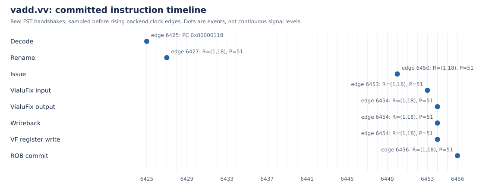

# 阶段一：环境与向量加法最终结果

实际干净构建/验收的作品源码提交：`3424efe852a1b4e2b26fa3efc25b233d94aec9a4`。最终作品提交由发布包的source-binding.json给出；处理器、NEMU、工作负载、配置与分析输入逐字节一致，后续文档/演示工具差异单独记录。

单核MinimalConfig，VLEN=128，真实NEMU差分开启。emu SHA256：`dd1f0323f96d567e26e9ba25336db5f9cbcc3a9ebb55821665110fc993e30e31`；正常REF SHA256：`baa2f11e3190d4dd3e7d6107c46ca6795c9b574978a070fdd7bdfafaf8372225`。

独立检出先完成未修改香山/NEMU的全量构建与标准向量vadd，再应用补丁并从空硬件生成目录重建扩展核。复用固定外部工具与下载缓存，不复制开发目录的RTL、C++或模拟器；这不是全新操作系统验证。

原核emu SHA256：`b887f745a2c04b9bc2db4e9b8d0d47125068dcf69772a403b5e9677a01b1a878`。原核vadd目录：`/home/yh/cie/vdot-kmhv2-repro-20261105/reports/rtl-vadd_test-20261105T045747Z-3710923`；扩展核vadd目录：`/home/yh/cie/vdot-kmhv2-repro-20261105/reports/rtl-vadd_test-20261105T063407Z-3781349`。两者均有VADD_PASS、Difftest启用、GOOD TRAP和原始退出0。

目标编码0x02850657，PC=0x80000118，配置SEW=8、VL=16、LMUL=1。完整128位实测结果为34302c2824201c1814100c080400fcf8。

| 环节 | FST上升沿序号 | 关联 |
|---|---:|---|
| 译码 | 6425 | PC=0x80000118 |
| 重命名 | 6427 | ROB=(1,18)，P=51 |
| 发射 | 6450 | ROB=(1,18)，P=51 |
| FU输入 | 6453 | ROB=(1,18)，P=51 |
| FU结果 | 6454 | ROB=(1,18)，P=51 |
| 控制写回 | 6454 | ROB=(1,18)，P=51 |
| 物理向量写入 | 6454 | ROB=(1,18)，P=51 |
| ROB提交 | 6456 | ROB=(1,18)，P=51 |

同PC译码尝试的边沿为[1502, 6023, 6364, 6425]，按实际提交反向选择对应重命名并限定ROB动态区间，不能仅用重用的物理目的拼接。叶FU入口的ROB取自同拍父Exu接收入口，不借用延后ctrlPipe。边沿序号在采集内计数、上升沿前采样，不是cycle CSR或物理频率。

完整部署命令、固定版本、失败修复与资源参数见构建文档和证明材料包operation-logs/build-history。原始环境输出包含赛题所需团队和本机IP；公开录屏只省略IP展示，原始日志仍留在证明材料中。
