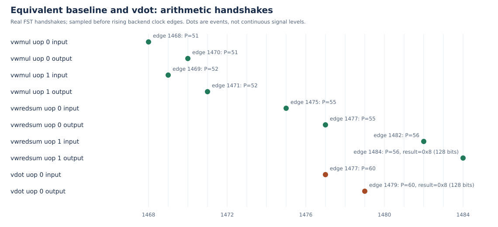

# 阶段三：协同仿真与实测性能最终结果

实际干净构建/验收的作品源码提交：`3424efe852a1b4e2b26fa3efc25b233d94aec9a4`。最终作品提交由发布包的source-binding.json给出；处理器、NEMU、工作负载、配置与分析输入逐字节一致，后续文档/演示工具差异单独记录。

单核MinimalConfig，VLEN=128，真实NEMU差分开启。emu SHA256：`dd1f0323f96d567e26e9ba25336db5f9cbcc3a9ebb55821665110fc993e30e31`；正常REF SHA256：`baa2f11e3190d4dd3e7d6107c46ca6795c9b574978a070fdd7bdfafaf8372225`。

Difftest启用全部32个128位向量寄存器和7项向量CSR比较，NEMU导出前缀1400字节；未修改checker、跳过规则或结果同步策略。未跳过vdot提交后参考模型独立推进，再比较完整架构向量状态。

故障库在独立源码副本中仅将结果低位异或1，正常源码与正常库不改写；同一emu/smoke/flash依次运行正确→错误→恢复。负例实际字段为v12_low，REF=9、DUT=8，ABORT且原始退出1；提交历史同时要求首个02a4060b为未跳过、非delayed的v12写入。

负例首条vdot提交PC为0x00000000800001cc。差异日志：

```text
v12_low different at pc = 0x0080000164, right = 0x0000000000000009, wrong = 0x0000000000000008
```

差异行的诊断PC不保证是vdot地址，不能混淆。恢复正常库后smoke通过，输入SHA256不变。

异常契约v2：后期配置检查cause2/xtval0；非零vstart由译码拒绝、xtval为指令位。NEMU仅消费一次自定义非架构标志，普通非法0x7b保持原报告；没有关闭TVAL或豁免比较。

## 程序片段的60条RTL样本

原始日志：/home/yh/cie/vdot-kmhv2-repro-20261105/reports/rtl-benchmark-20261105T063741Z-3787238/run.log

测量范围包含必要向量配置、循环与末尾结果存储，属于程序片段周期，不能解释为裸功能单元延迟。

| 依赖链 | 迭代数 | 基线周期中位数（范围） | vdot周期中位数（范围） | 加速比 |
|---|---:|---:|---:|---:|
| 无 | 32 | 473（473–491） | 154（153–187） | 3.071 |
| 无 | 128 | 1689（1687–1705） | 406（406–423） | 4.160 |
| 无 | 512 | 6553（6551–6568） | 1414（1413–1430） | 4.634 |
| 有 | 32 | 730（730–752） | 280（280–302） | 2.607 |
| 有 | 128 | 2746（2746–2746） | 952（952–952） | 2.884 |
| 有 | 512 | 10810（10810–10825） | 3656（3640–3657） | 2.957 |

基线用vwmul生成16位有符号乘积、vwredsum扩宽归约到32位，预先清零高96位。两路径输入、目标布局、内存条件和测量边界一致；每种长度32/128/512预热后重复5次，区分真结果依赖和无显式结果依赖。波形关闭。

基线逐次完成清零和配置恢复，未测量跨迭代复用已清零目标等循环优化，也未穷举最优RVV序列。加速比仅相对此处公开的等价组合，不推广为所有软件实现的最佳加速比。

vdot循环使用ta/ma，原有派发/发射逻辑可消除通用旧vd源等待；本实现没有专门删除该源。基线按算法切换SEW和tu/mu以保证完整结果布局，末尾恢复相同vtype；该片段结果不能推广到所有tu/mu配置。

## 实际算术路径与独立突发吞吐

| 算术及微操作 | P | 输入边沿 | 结果边沿 | 周期 |
|---|---:|---:|---:|---:|
| multiply uop0 | 51 | 1468 | 1470 | 2 |
| multiply uop1 | 52 | 1469 | 1471 | 2 |
| reduce uop0 | 55 | 1475 | 1477 | 2 |
| reduce uop1 | 56 | 1482 | 1484 | 2 |
| vdot uop0 | 60 | 1481 | 1483 | 2 |

此次等价基线首个乘法接收到最终归约结果为16周期，含配置、清零及依赖调度；vdot输入至结果为2周期。归约uop0写内部临时物理目的，uop1才写v12完整结果8，不能把部分和当作最终结果。

扩宽乘法uop0包含8个有效16位乘积，uop1为未参与本次归约的尾部；后者的物理结果不作为点积语义值。



另有5组×8条独立vdot的输入和输出连续逐周期握手，逐条核对实际两源的黄金和、完整128位结果、ROB、P与提交。这些突发的实测接收/输出间隔为1周期，不代表任意负载的持续吞吐上限。片段周期不能称为FU延迟。

实现融合乘法/归约并减少SEW配置和结果整理，复用VIMac槽位，与普通向量乘法竞争资源。未部署LLM或推荐模型，没有综合、时序、面积或功耗数据，不声称端到端应用、面积、频率或能效收益。
