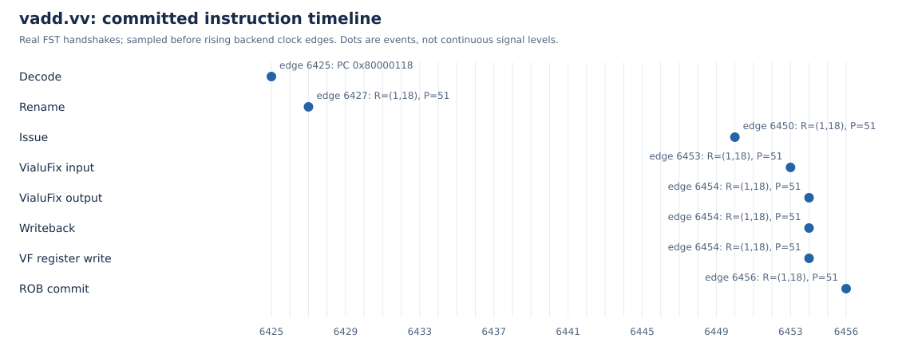

# 第一阶段：环境部署、操作日志与向量加法执行过程

队伍：全栈漏洞队。参赛单位：西安电子科技大学。

## 1.1 环境部署验证

固定昆明湖V2单核MinimalConfig，保留VLEN=128的向量实现。先在未修改原核运行vadd，再在完成vdot扩展的独立构建中回归vadd。程序由香山整核仿真执行，并通过仿真UART输出：

```text
hello xiangshan, I am 全栈漏洞队, <本机IP>
VADD_PASS
```

本机IP在构建工作负载时由hostname -I读取并写入identity.h，随后由RTL执行的程序打印。

vadd验收运行共847条指令、7493周期，GOOD TRAP PC=0x80000054，进程退出码为0。

## 1.2 完整部署与操作过程日志

命令运行时产生的原始日志以.log文件保存，完整部署记录包含原有225份命令、日志、版本和恢复文件，以及补充的干净提交构建与验收记录，提供顺序索引与SHA256校验。本条目直接提供原始文件及索引。

| 顺序 | 实际操作 | 可核对的记录与结果 |
|---|---|---|
| 1 | 未修改原核先验收 | pristine/vadd/run.log显示dirty: 0、问候、VADD_PASS、真实差分与GOOD TRAP，退出0 |
| 2 | 准备独立源码 | 固定22个仓库，记录每个提交和补丁；未复制旧RTL、C++、目标文件或NEMU二进制 |
| 3 | 工具、依赖与负载准备 | Java、Mill、firtool、Verilator、RISC-V GCC版本及摘要；补丁重放、裸机镜像和NEMU构建命令与退出码 |
| 4 | Chisel生成 | 10分43.10秒，最大RSS 4104264KiB，退出0 |
| 5 | firtool生成 | 5分37.32秒，最大RSS 4438832KiB，退出0 |
| 6 | 原生生成失败与恢复 | 首次退出137；两次文件堆尝试因大量写回停止，原日志保留 |
| 7 | 系统交换空间恢复 | 用户启用8GiB临时交换空间；swapon --json不兼容后改读/proc/swaps验证；不修改fstab |
| 8 | 模型生成、C++续编译 | 原生模型生成后调整并行度，最后4路续编译15分11.40秒并退出0；该耗时只属于最后续编译段 |
| 9 | 整核运行 | 正式vadd、vdot功能、真实差分及性能验收各有原始运行目录和输入摘要 |

本轮是同机固定工具条件下的干净源码复现：复用已记录版本的外部工具与Maven/Git下载缓存，关闭编译缓存。没有进行新操作系统重装。工作负载使用项目自带裸机启动与链接脚本，AM未初始化。

环境准备参考见BOOTSTRAP.md；完整构建命令和资源条件见BUILDING.md；失败、恢复与实际目录见CLEAN_REPRODUCTION.md。以上三份原文与225份记录随本阶段日志包提供。用户回传的交换空间终端输出保留来源说明，未冒充自动采集的终端历史。[R1]

## 1.3 向量加法指令执行过程文档

### 1.3.1 程序、输入与预期结果

目标指令PC=0x80000118，机器码0x02850657。配置SEW=8、VLEN=128、LMUL=1、VL=16、vstart=0、vm=1，tu/mu策略，16项均参与。[R5]

```text
8000010c: c0087057  vsetivli zero,16,e8,m1,tu,mu
80000110: 02088407  vle8.v v8,(a7)
80000114: 02060507  vle8.v v10,(a2)
80000118: 02850657  vadd.vv v12,v8,v10
8000011c: 02070627  vse8.v v12,(a4)
```

数组a[i]=i-8载入v8，b[i]=3*i载入v10，期望v12[i]=4*i-8。元素0至15的实测值依次为：-8、-4、0、4、8、12、16、20、24、28、32、36、40、44、48、52。完整128位结果为0x34302c2824201c1814100c080400fcf8；最右字节0xf8是元素0。

汇编操作数顺序为vd,vs2,vs1，所以本例vs2=v8、vs1=v10。执行单元src0=v10，src1=v8；两源原始128位数据已按16个字节逐项核对。C程序把v12存回内存后逐项断言，再输出VADD_PASS。

### 1.3.2 从原始波形关联同一条动态指令



图1：原始FST接口事件的派生时序图。时间刻度1ps，在backend.clock上升沿之前采样；edge是捕获窗口内编号，不是客体cycleCnt或实际芯片频率。

| 观察事件 | 边沿 | 相对译码 | 对应接口 |
|---|---:|---:|---|
| 译码接收 | 6425 | 0 | inner_ctrlBlock.decode.io_in_0 |
| 重命名输出接收 | 6427 | 2 | inner_ctrlBlock.rename.io_out_0 |
| 调度输出接收 | 6450 | 25 | inner_vfScheduler.io_toDataPathAfterDelay_1_0 |
| FU输入接收 | 6453 | 28 | inner_vfExuBlock.exus_2.VialuFix |
| FU结果握手 | 6454 | 29 | inner_vfExuBlock.exus_2.VialuFix |
| 控制侧写回有效 | 6454 | 29 | inner_wbDataPath.io_toCtrlBlock_writeback_15 |
| 物理向量寄存器写入 | 6454 | 29 | inner_wbDataPath.io_toVfPreg_1 |
| ROB提交有效 | 6456 | 31 | inner_ctrlBlock.rob.commit_0 |

接口根路径为TOP.SimTop.cpu.l_soc.core_with_l2.core.backend。6427分配ROB=(flag=1,value=18)、物理目的P51、逻辑目的v12，后续事件沿此动态身份关联。

同一PC还曾在1502、6023、6364出现；早先6366也分配过P51，但ROB=(0,6)。因此同时使用PC、ROB分配至复用的动态区间和物理目的，不能只按PC或P51拼接。FU叶级身份从同周期父执行单元回绑；物理寄存器写口自身没有ROB，需在该动态区间核对P51与完整结果，再以独立提交事件收尾。

### 1.3.3 逐阶段解释

译码：6425时目标PC/机器码与valid、ready共同有效，接收vadd.vv。随后译码信息选择现有向量整数ALU，op=64、vecwen=1、uop=0。未把更早的同PC事件自动视为最终提交实例。

重命名：6427时逻辑v12映射到新物理P51，并分配ROB=(1,18)。寄存器重命名提供后续源目的身份，维护推测映射和回滚所需信息；本次具体映射以实测为准。[R2]

调度与读源：6450发生向量调度输出握手，6453同一身份到达执行单元。现有DataPath及旁路路径负责形成操作数；此时src0、src1与数组一致，src4=16。重命名到调度相隔23拍。[R3]

执行：已有VIAluFix把128位数据拆入64位运算模块，按SEW执行同宽逐元素加法。固定源码VialuCfg的CertainLatency(1)与本次6453输入、6454结果的1拍相符。该观察属于vadd，不混用vdot的2拍结果。[R6][R7]

写回：6454时FU、父执行单元、控制侧writeback_15与toVfPreg_1给出同一完整结果。控制写回关联ROB=(1,18)、P51、vecwen=1；物理向量寄存器写入P51。物理写入还不能证明架构提交。

提交：6456时rob.commit_0给出同一PC、机器码、ROB、v12和P51。ROB在完成、顺序及异常约束满足后提交；随后程序存储、自检并正常结束。[R4]

本次decode到commit为31拍，其中FU输入到输出为1拍。两者测量边界不同。原始FST、825项信号清单、事件JSON、目标事件CSV及反汇编均随评审包保存。

## 参考资料

- [R1] [香山官方开发环境](https://docs.xiangshan.cc/zh-cn/latest/tools/xsenv/)
- [R2] [昆明湖V2重命名设计](https://docs.xiangshan.cc/projects/design/zh-cn/kunminghu-v2/backend/CtrlBlock/Rename/)
- [R3] [昆明湖V2 DataPath设计](https://docs.xiangshan.cc/projects/design/zh-cn/kunminghu-v2/backend/DataPath/DataPath/)
- [R4] [昆明湖V2 ROB设计](https://docs.xiangshan.cc/projects/design/zh-cn/kunminghu-v2/backend/CtrlBlock/Rob/)
- [R5] [RISC-V Vector 1.0，同宽整数加法](https://docs.riscv.org/reference/isa/v20260120/unpriv/v-st-ext.html)
- [R6] [固定源码VIAluFix.scala](https://github.com/OpenXiangShan/XiangShan/blob/7b16188f7f18a97be69c9b1a2dae8a446eec3b47/src/main/scala/xiangshan/backend/fu/wrapper/VIAluFix.scala)
- [R7] [固定源码FuConfig.scala](https://github.com/OpenXiangShan/XiangShan/blob/7b16188f7f18a97be69c9b1a2dae8a446eec3b47/src/main/scala/xiangshan/backend/fu/FuConfig.scala)
