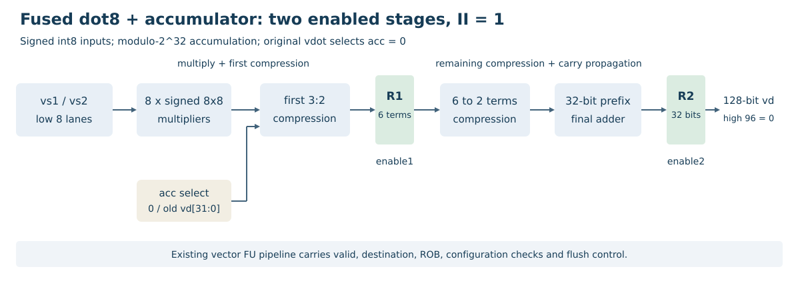

# 第二阶段：设计与基础测试

## 2.1 指令与数据通路

`vdot.vv`计算两源低8对有符号int8点积，结果保存为低32位补码，高96位清零。支持SEW=8、VLEN=128、LMUL=1、VL=8、vstart=0、vm=1。八项和范围为[-130048,131072]。

新增的`vdot.acc`使用独立编码，在点积上加入旧目标低32位，按模2^32回绕。普通点积取累加输入0，两条指令共用一套两级算术路径。

第一级计算8路有符号8×8乘法并完成首层3:2压缩，寄存6项和/进位；第二级继续压缩至两项，经32位并行前缀加法寄存输出。源寄存器和旧目标均在写回前读取，支持源目标重叠。

指令在VecDecoder中识别为FuType.vimac，经现有向量调度、读源、VIMacU、写回和ROB提交。普通vdot的第三源为SrcType.no；累加版第三源为SrcType.vp，并设置isDependOldVd，保留真实累加依赖。两级使能来自VecPipedFuncUnit。完整说明见[设计文档](../DESIGN.md)。

## 2.2 RTL实现

| 文件 | 内容 |
|---|---|
| [香山补丁](../../patches/xiangshan.patch) | 相对固定昆明湖V2上游的完整Chisel改动 |
| [完整修改文件](../../experiments/acc/generated/README.md) | 译码、依赖、数据通路、执行单元和NEMU源码 |
| [VdotAccRetimedDatapath.sv](../../rtl/VdotAccRetimedDatapath.sv) | 当前共享算术模块 |
| [VIMacU.sv](../../rtl/VIMacU.sv) | 同次整核生成的执行单元包装器 |
| [生成来源](../../rtl/provenance.json) | 实际构建和模块摘要 |

8路乘法及压缩路径由两条自定义指令共用。其调度槽位仍与标准向量乘法竞争，没有增加独立发射端口。

## 2.3 正数、负数与边界测试

[基础程序](../../examples/vdot_basic.c)逐例加载两源及非零旧目标，检查完整128位结果。源高64位为无关数据。

| 用例 | 两源低8项 | 期望结果 | 完整128位结果 |
|---|---|---:|---|
| 正数 | 1 / 1 | 8 | 00000000000000000000000000000008 |
| 负数 | -1 / 1 | -8 | 000000000000000000000000fffffff8 |
| 最小值乘最小值 | -128 / -128 | 131072 | 00000000000000000000000000020000 |
| 最小值乘最大值 | -128 / 127 | -130048 | 000000000000000000000000fffe0400 |
| 最大值乘最大值 | 127 / 127 | 129032 | 0000000000000000000000000001f808 |
| 零 | 0 / -128 | 0 | 00000000000000000000000000000000 |

[当前整核运行记录](../data/basic-current/README.md)中的六项实际结果与上表一致，Difftest启用，GOOD TRAP、原始退出0。

负数只保存在低32位补码中。正边界131072检查超过18位有符号正上限的情况，高96位均检查为0。

当前共享路径的[整核回归](../data/acc-results/validation/results.json)覆盖6组定向和1000组唯一随机输入，每组使用6种寄存器关系及两种尾策略，包含2012次普通vdot对照。累加版另外覆盖非零初值、正负回绕、单/四累加链和源高位不相关检查。

[流水测试](../data/acc-results/pipeline/results.json)执行1664条累加指令，覆盖独立目的、vadd生产者、源目标重叠链及分支两种方向；[边界寄存器测试](../data/acc-results/registers/results.json)覆盖v0/v31。各组均由真实RTL/NEMU差分检查。

普通平衡树及四级原型作为[资源对照](../资源与时序评估.md)保存，当前算术模块资源和时序见[实验结果](../累加融合实验结果.md)。
