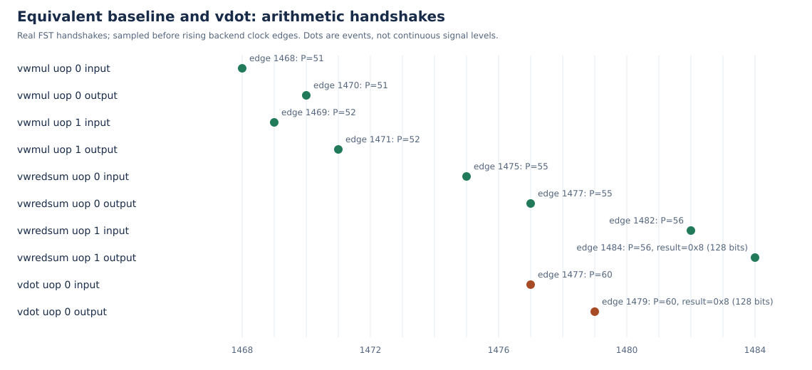

# 第三阶段：NEMU、协同仿真、基线与延迟加速分析

队伍：全栈漏洞队。参赛单位：西安电子科技大学。

## 3.1.1 NEMU指令扩展

参考模型固定为NEMU提交d772a9d9e06f663d529bd1c6518480c1ee59ded2，改动完整保存在patches/nemu.patch。译码使用与RTL相同的custom-0模式，先检查支持域，再读取两源低8个字节，分别作int8有符号解释，以int32累加。

全部源值读取完成后才写目标，保证vd与任一源重叠时不破坏尚未读取的数据。写入低64位时采用(uint32_t)result，使低32位为补码、该64位上半部为零；高64位写零。

支持域和非法配置行为与RTL一致。NEMU在自定义异常路径消费一次非架构标记，用于对齐执行期与译码期xtval区别；普通非法0x7b保持原有报告。向量状态与TVAL均参与差分比较。

## 3.1.2 NEMU与RTL协同仿真验证

Difftest比较全部32个128位向量寄存器和7项向量CSR，参考模型导出前缀1400字节。每次vdot提交后，NEMU独立执行，再比较架构状态。正式验收的全部运行记录输入二进制、仿真器、参考库与flash的SHA256。

| 整核用例 | 验证内容 | 实际结果 |
|---|---|---|
| vadd | 标准向量加法控制回归 | 847指令、7493周期，GOOD TRAP、退出0 |
| smoke | 6组基础输入、5模式、7非法形式 | 4084指令、12791周期，GOOD TRAP、退出0 |
| register | v0/v31、源目的边界与寄存器保持 | 完成标记、GOOD TRAP、退出0 |
| random | 1000组5模式，4000次合法vdot及1000次基线 | 786591指令、593917周期，退出0 |
| pipeline | 64组、1664条vdot、依赖与分支 | 290027指令、181649周期，退出0 |
| benchmark | 三长度、依赖/独立的60条样本 | 计算结果检查、真实差分和退出0 |
| latency | 基线及vdot真实FST探针 | 完成标记、GOOD TRAP、退出0 |

### 检验差分机制能够发现错误

在独立NEMU源码副本中将点积结果最低位异或1，生成故障库；正常源码及正常参考库不修改。同一RTL仿真器、smoke、flash依次运行正确参考、故障参考、恢复正确参考。

```text
v12_low different at pc = 0x0080000164,
right = 0x0000000000000009,
wrong = 0x0000000000000008
```

上述为原日志差异行按版面折行。故障运行ABORT且原始退出1，正确和恢复运行均GOOD TRAP并退出0。该诊断PC不是首条vdot的提交地址；实际vdot提交PC为0x800001cc，提交历史同时核实该指令未skip、未delayed且写v12。

原始正例、负例、恢复三份日志、匹配字段、退出码和受控输入摘要均随包保存。新增逐例基础测试也启用同一套真实差分，实际结果见第二阶段。

## 3.2 用已有向量指令实现等价基线

### 3.2.1 基础基线

```text
vsetivli zero,8,e8,m1,tu,mu
vwmul.vv v16,v8,v10
vsetivli zero,4,e32,m1,tu,mu
vmv.v.i v24,0
vsetivli zero,8,e16,m1,tu,mu
vwredsum.vs v24,v16,v24
```

vwmul生成16位有符号乘积，vwredsum将其扩宽归约到32位，避免16位累加溢出。归约前清零完整128位目标，保留高96位零；随后按测试需要移到公共输出寄存器并存储。基线和vdot使用相同输入和完整结果布局，不以部分和替代最终结果。

### 3.2.2 优化候选与公平比较

第二条候选将完整目标清零及独立零种子移到计时外，循环内计算/配置从6条减为4条。两条都经过独立黄金模型和真实差分。

两条候选均使用LMUL=1。512块TA含访存中，基础序列7668周期，复用零值候选9116周期；该场景采用基础序列作为较快基线。

### 3.2.3 基线选取规则

主要加速比均使用两条等价RVV序列中较快者：在相同输入、尾部策略、循环长度和计时边界下，分别计算5次重复的中位周期，再选取两条基线中较小的中位数作为分子。完整目标清零及零种子复用规则与对应计时边界一同记录。

## 3.3 延迟加速分析报告

### 3.3.1 功能单元、组合路径与程序片段的边界



| 真实算术操作 | uop | 物理目的 | 输入边沿 | 结果边沿 | 延迟 |
|---|---:|---:|---:|---:|---:|
| 扩宽乘法 | 0 | 51 | 1468 | 1470 | 2 |
| 扩宽乘法 | 1 | 52 | 1469 | 1471 | 2 |
| 扩宽归约 | 0 | 55 | 1475 | 1477 | 2 |
| 扩宽归约最终结果 | 1 | 56 | 1482 | 1484 | 2 |
| vdot | 0 | 60 | 1477 | 1479 | 2 |

基线首个乘法输入至最终归约结果为1484-1468=16周期，包含配置、清零和依赖调度；vdot输入到结果为1479-1477=2周期。在此测量边界下，组合路径与专用路径的延迟比为16/2=8.000。

归约uop0只产生内部部分和，uop1才写完整v12=8。扩宽乘法uop1处理未参与本次归约的尾部，不能取其结果冒充点积。波形通过ROB动态区间、物理目的与实际结果关联，采样边沿不等于客体CSR周期或芯片频率。

### 3.3.2 基础程序片段周期

性能运行关闭波形，预热后测32、128、512次循环，每组重复5次，保留原始周期和校验值。边界包含必要配置、循环和末尾结果存储，以下是中位数与最小/最大范围。

| 依赖 | 次数 | 基线周期，中位数（范围） | vdot周期，中位数（范围） | 基线/vdot |
|---|---:|---|---|---:|
| 无显式结果依赖 | 32 | 473（473-491） | 154（153-187） | 3.071 |
| 无显式结果依赖 | 128 | 1689（1687-1705） | 406（406-423） | 4.160 |
| 无显式结果依赖 | 512 | 6553（6551-6568） | 1414（1413-1430） | 4.634 |
| 真实结果依赖 | 32 | 730（730-752） | 280（280-302） | 2.607 |
| 真实结果依赖 | 128 | 2746（2746-2746） | 952（952-952） | 2.884 |
| 真实结果依赖 | 512 | 10810（10810-10825） | 3656（3640-3657） | 2.957 |

加速比=等价基线周期/vdot周期。以上为60条基础样本，保留原有逐次清零及配置恢复边界；下节另测两条RVV候选和真实访存。

### 3.3.3 调度优化与真实数据搬运

前后共540条正式样本：保存原冻结before 270条，在新独立检出重新采集after 270条。每侧180条寄存器样本、90条含访存样本，均覆盖三长度和每组5次重复；逐组中位数、最小/最大值和原始数据随包保存。

| 512次或512块场景 | 修改前vdot | 修改后vdot | 较快RVV基线 | RVV/修改后vdot |
|---|---:|---:|---:|---:|
| 独立寄存器，TA | 625 | 625 | 3671 | 5.874 |
| 独立寄存器，TU | 3639 | 625 | 3657 | 5.851 |
| 真实依赖链，TA | 3639 | 3639 | 10807 | 2.970 |
| 真实依赖链，TU | 3639 | 3639 | 10807 | 2.970 |
| 含访存，TA | 3991 | 3991 | 7668 | 1.921 |
| 含访存，TU | 8262 | 8262 | 8283 | 1.003 |

TA指ta/ma，TU指tu/mu。每个访存块只计算8对int8：两源各加载8字节、源块跨度16字节、存储完整16字节结果。512块对应4096对有效输入，不是一条长向量归约。

本次修改将不读取旧vd的vdot第三源改为SrcType.no，独立TU场景3639/625=5.822倍改善；TA原有动态消除条件已能去掉该依赖，真实依赖链仍需等待两个真实源。36组普通RVV控制的前后中位周期全部一致。

直接比较两轮独立生成的1868份SV，只有DecodeUnit变化，其余1867份逐字节一致；VIMacU和VdotDatapath未变。算术流水级未改变，优化来自调度依赖处理。

两种策略、三种长度的内存内核中，vdot修改前后中位周期相同。512块含访存场景相对RVV基线的加速比分别为1.921和1.003。

### 3.3.4 结果复现

5组×8条独立vdot突发逐条核对两源黄金和、完整128位输出、ROB/物理目的及提交，接收与输出间隔均为1周期。

功能验收使用新编译正常NEMU库；严格A/B固定使用同一保存参考库，两类摘要分别记录。性能数据均为客体RTL周期，不使用宿主构建时间或NEMU指令数替代。15份性能数据/报告已从原始日志字节一致地重算。
