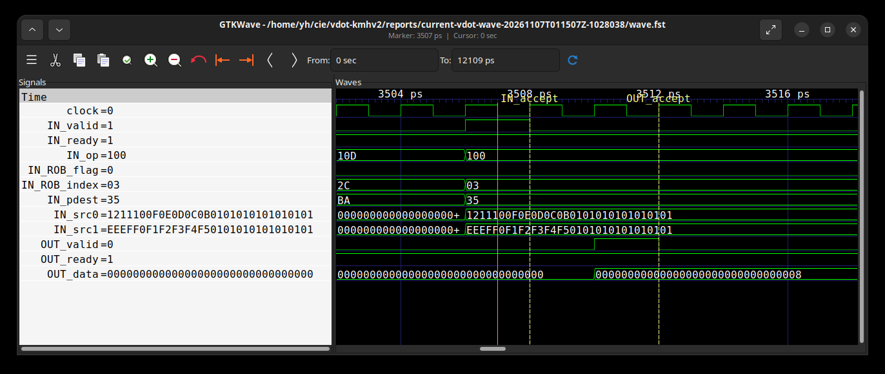
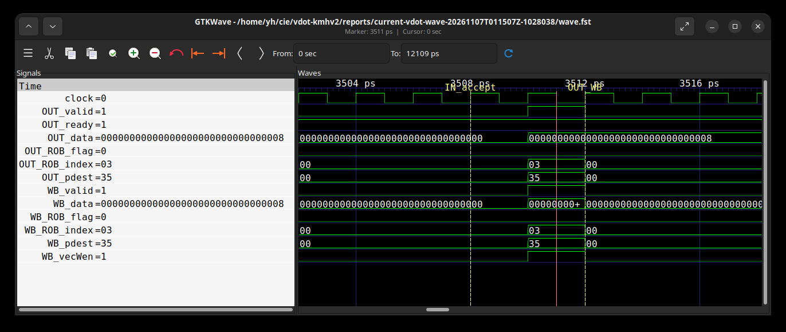
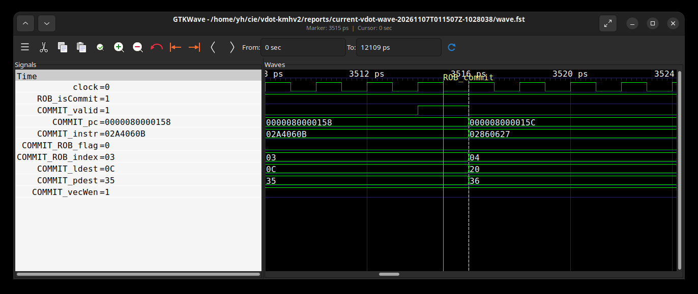
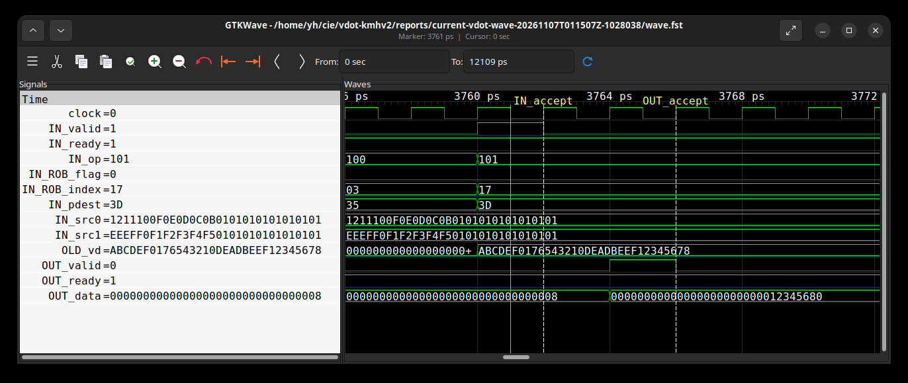
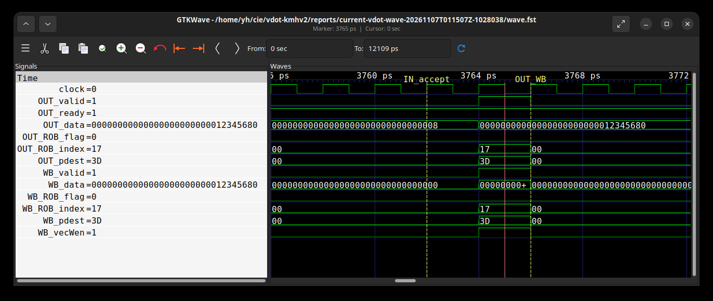

# 第三阶段：NEMU与协同仿真

## 3.1.1 NEMU指令扩展

NEMU基于固定提交d772a9d9e06f663d529bd1c6518480c1ee59ded2扩展。两条自定义指令使用与RTL相同的custom-0编码；软件循环独立计算低8对有符号int8乘积，全部源值读取后才写目标。累加使用uint32_t运算实现32位回绕。

早期译码非法检查覆盖向量状态、vill、非零vstart、整数LMUL寄存器对齐和masked目的v0；xtval为指令字。其余不支持配置在功能单元报告cause=2、xtval=0。NEMU镜像相同顺序。

## 3.1.2 RTL与NEMU协同仿真

Difftest比较向量寄存器和向量CSR。原始日志保留模型、工作负载、参考库、flash、命令和退出码。

| 测试 | 内容 | 结果入口 |
|---|---|---|
| 功能随机 | 1000组唯一随机、6组定向、6种关系、TA/TU，共22318次合法点积 | [完整差分](data/验证摘要.json) |
| 流水 | 1664条累加指令、生产者、别名和分支 | [流水记录](data/验证摘要.json) |
| 边界寄存器 | v0/v31及6种关系、两种尾策略 | [寄存器记录](data/验证摘要.json) |
| 交叉异常 | 原vdot和累加版各24种配置 | [异常记录](data/验证摘要.json) |
| 故障与恢复 | 同一RTL分别接正确、错误、恢复参考库 | [差分反例](data/验证摘要.json) |

故障探针使用非零累加值，正确结果为0x12345680。故障参考给出0x12345681，Difftest报告v12_low差异；三轮退出码为0、1、0。提交记录确认累加指令正常执行并参与比较。

48例异常测试在旧参考中检出20例mtval错误，修正前置对齐和v0重叠检查后全部通过。初始参考、修正参考及每次实验的摘要分别保存在数据中。

## 当前整核波形与点积累加执行过程

本节波形来自当前提前压缩与前缀加法共享实现，整核源码为14c8b3489a610d9b210ab57b5bf30901f8cf4263。带波形模型复用性能模型逐字节相同的整核生成RTL，重新编译并启用FST记录；原无波形性能模型保持不变。

[波形程序](../examples/vdot_wave.c)分别执行一次vdot.vv和vdot.acc。两源低8项均为1，高64位设置互不相同的无关数据；两次执行前均把旧目标完整加载为0xabcdef0176543210deadbeef12345678。普通点积期望8，累加版期望0x12345678+8=0x12345680，两者高96位均清零。

程序检查完整128位结果，实际RTL/NEMU差分通过，核心dirty标志为0，退出码为0，并输出：

```text
CURRENT_TRACE_PASS dot_low32=8 acc_low32=305419904 high96=0 cases=2
```

以下六图为GTKWave直接读取本次真实FST的窗口截图。IN和OUT表示Vimac及其父执行单元的输入、输出，OLD_vd是第三源，WB表示writeback_13，COMMIT表示ROB提交槽0。数据和寄存器编号以十六进制显示，红色取值游标放在命名上升沿标记之前。

### 图1：当前vdot.vv输入接收



取值游标3507位于输入采样沿3508之前。IN_valid=1、IN_ready=1、IN_op=0x100，表示接收普通点积。IN_ROB_flag=0、IN_ROB_index=0x03、IN_pdest=0x35，对应ROB=(0,3)、P53。两源低64位均为0x0101010101010101，高64位不同；预期只计算低8对元素，结果为8。

### 图2：当前vdot.vv输出与写回



取值游标3511位于输出采样沿3512之前。OUT_valid与OUT_ready均为1，完整OUT_data为0x00000000000000000000000000000008。输出的ROB索引0x03和目的0x35与图1一致。WB_valid、WB_vecWen同时有效，WB_data和指令身份相同，结果进入控制侧写回通路。

### 图3：当前vdot.vv提交



取值游标3515位于提交采样沿3516之前。ROB_isCommit和COMMIT_valid均为1，PC=0x80000158，指令字0x02a4060b；ROB=(0,3)、P53保持一致，逻辑目的0x0c对应v12。至此，同一条动态指令的接收、结果、写回和提交均有对应事件。

### 图4：当前vdot.acc读取旧累加器



取值游标3761位于输入采样沿3762之前。IN_valid和IN_ready均为1，IN_op=0x101选择累加变体。ROB索引0x17对应十进制23，目的0x3d对应P61。OLD_vd显示完整旧目标0xabcdef0176543210deadbeef12345678；参与累加的是低32位0x12345678。

本程序使用ta/ma策略，第三源仍读取非零旧目标。这与累加译码保留SrcType.vp及isDependOldVd的实现一致。普通点积和累加版使用相同源数据，但前者忽略旧目标，后者保留真实累加依赖。

### 图5：当前vdot.acc结果与写回



取值游标3765位于输出采样沿3766之前。OUT_valid、OUT_ready、WB_valid和WB_vecWen均为1，OUT_data与WB_data均为0x00000000000000000000000012345680。输出和写回的ROB=(0,23)、P61相同。旧目标高96位原本非零，此时已经清零，符合结果布局要求。

### 图6：当前vdot.acc提交


取值游标3769位于提交采样沿3770之前。ROB_isCommit、COMMIT_valid、COMMIT_vecWen有效，PC=0x80000196，指令字0x06a4060b。ROB索引0x17、物理目的0x3d、逻辑目的0x0c与输入和输出对应，确认累加指令完成架构提交。

### 同一动态指令的时序关联

| 指令 | FU输入上升沿 | 输出/写回上升沿 | ROB提交上升沿 | FU延迟，拍 |
|---|---:|---:|---:|---:|
| vdot.vv | 1754 | 1756 | 1758 | 2 |
| vdot.acc | 1881 | 1883 | 1885 | 2 |

表中编号是捕获窗口内的backend.clock上升沿序号。相邻上升沿间隔两个FST时间步，普通点积输入3508到输出3512、累加输入3762到输出3766均经过两拍。本例两条指令的输出到提交另相隔两拍；这是本程序的观察值，不能推广为所有指令的固定提交延迟。

FU输入的ROB身份从同周期父执行单元回绑。物理寄存器写口本身没有ROB，分析脚本在同一动态区间内核对目的、完整数据及对应写回周期，避免仅凭相同PC或目的寄存器拼接事件。数据只在valid/ready共同有效时计入一次接收，valid无效时保持的数据不代表新结果。

同一探针在无波形和带波形构建中均执行925条指令、8572周期，结果一致。这项对照用于检查执行一致性；性能结论仍取原无波形模型的180条基准样本。FST的ps刻度用于仿真事件排序，实际电路时序由独立STA评估。

接口根路径为TOP.SimTop.cpu.l_soc.core_with_l2.core.backend，FU路径为inner_vfExuBlock.exus.Vimac。运行、FST、事件及截图的摘要保存在[验证摘要](data/验证摘要.json)，采集和分析命令见[复现说明](复现说明.md)。原始FST和完整运行日志在本地保留。
