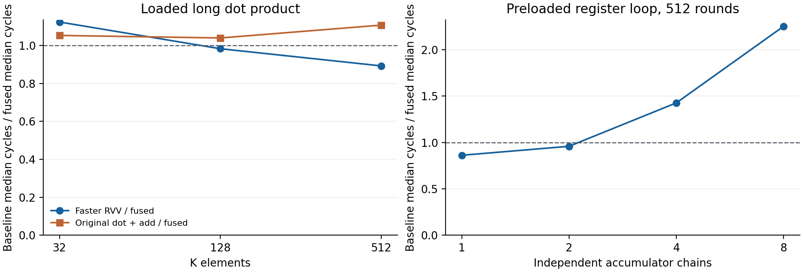

# 第三阶段：基线与性能分析

## 3.2 等价RVV基线

[基准程序](../examples/acc_benchmark.c)比较四条路径：普通vdot加显式e32加法、RVV8扩宽乘法与扩宽归约、RVV16通道累加与末尾归约、四累加器vdot.acc。四条路径从相同连续int8数组计算完整K维点积，最终只存一次16字节结果，低32位为结果，高96位为0。

RVV16中乘积为int16，通道累加为int32，末尾统一归约；测试K≤512时中间值不会溢出。每组预热一次后重复5次，主要基线取两条RVV路径中较快的中位数。

## 3.3 周期测量与加速比

性能分析比较完成同一计算所需的处理器周期。基准程序在计时边界执行fence rw,rw并读取cycle CSR，以前后计数差作为片段周期；计时期间关闭波形，保留RTL/NEMU差分。

本报告区分以下测量范围：

| 指标 | 起止边界 | 说明 |
|---|---|---|
| 功能单元延迟 | FU输入握手至对应输出握手 | 当前共享实现中，vdot.vv与vdot.acc均观测为2拍 |
| 寄存器程序片段周期 | 输入预加载后的计时起点至循环和末尾存储结束 | 包含循环、必要配置和结果存储 |
| 含访存长点积周期 | 向量初始化之前至完整结果存储后的计时终点 | 包含加载、计算、跨块累加和结果整理 |

长点积相对RVV的加速比定义为：

```text
加速比 = 较快等价RVV实现的中位周期 / 自定义指令方案的中位周期
```

大于1表示自定义方案的片段周期更短，等于1表示相当，小于1表示基线更快。先分别求两种RVV实现的五次测量中位数，再选择较快者，所有测量均检查相同的完整128位结果。

当前共享实现已使用相同整核生成RTL重新构建带FST记录的模型，两种指令的实测输入到输出均为2拍，逐图分析见[当前整核波形](三阶段协同仿真文档.md)。下列180条周期样本仍取原无波形性能模型；该模型的二进制摘要保持不变。程序片段周期同时受调度、配置、循环和访存影响。

### 含访存长点积

计时包含向量初始化、配置、加载、循环、跨块累加、末尾合并或归约、完整结果存储和结束fence。黄金计算和输出哨兵初始化在计时外。共有60条正式样本，下面为中位周期。

| K | 原vdot加法 | RVV8 | RVV16 | vdot.acc | 较快RVV/acc |
|---:|---:|---:|---:|---:|---:|
| 32 | 119 | 127 | 128 | 113 | 1.124 |
| 128 | 183 | 208 | 173 | 176 | 0.983 |
| 512 | 453 | 549 | 365 | 409 | 0.892 |

K=32时融合片段更快；K=128和512时RVV16更快。较长归约将最终归约推迟到末尾，减少了固定8项块的结果整理成本。

以K=32为例，两种RVV实现的中位周期为127和128，选择127作为基线；融合方案为113周期，加速比为127/113=1.124。K=512时，加速比为365/409=0.892，表示这组长点积中RVV16更快。普通vdot加显式加法在三个长度上相对较快RVV的比例依次为1.067、0.945和0.806。

四条路径每32项的循环指令数分别为28、28、16和22。各分片同名函数入口PC相同，两源间距512字节、数组按64字节对齐，输入基址可能不同。各组独立预热。

### 单链和多链

源和种子在计时外预加载，比较原vdot加法与融合指令。独立链数为1/2/4/8，轮数为32/128/512，每组重复5次，共120条样本。下表为512轮中位周期。

| 独立链数 | 原vdot加法 | vdot.acc | 原路径/融合 |
|---:|---:|---:|---:|
| 1 | 3137 | 3639 | 0.862 |
| 2 | 3490 | 3640 | 0.959 |
| 4 | 5201 | 3643 | 1.428 |
| 8 | 9814 | 4353 | 2.255 |

原路径的真实递推只经过显式加法，融合路径的递推经过点积指令，因此单链融合更慢。4条和8条独立链提供了更多并行调度输入，融合路径的片段周期更短。这里测量的是包含循环、配置和末尾存储的程序片段。

本表的分子是“原vdot加显式加法”的周期，分母是vdot.acc周期，用于评估累加融合的效果；与前表采用RVV作为基线的加速比区分列示。增加独立链数可以暴露更多并行度，片段周期比同时反映调度和指令开销。



### 算术模块资源与时序

使用Nangate45 typical、1.10 V、25°C，ABC目标1000 ps，每个设计只映射一次，同一网表分别检查1/1.5/2.5 ns。输入/输出延迟100 ps、输入转换50 ps、负载5 fF、不确定度20 ps，理想时钟、零互连。包装器将两级使能绑定到公共enable，独立使能由功能测试覆盖。

| 算术结构 | 面积，Liberty属性单位 | 1.5 ns建立裕量，ns |
|---|---:|---:|
| 原两级点积 | 4944.408 | +0.351741 |
| 平衡归约后串累加 | 5431.188 | -0.561671 |
| CSA与普通最终加法 | 5733.896 | -0.220036 |
| CSA与前缀加法 | 5830.188 | -0.055645 |
| 提前压缩与前缀，单元输出 | 5608.344 | +0.100698 |
| 提前压缩与前缀，整核实际输出 | 5519.500 | +0.136429 |

提前压缩版在同轮单元对照中较未重定时前缀版减少3.805%面积，并使1.5 ns建立裕量转正。实际整核生成模块较原点积增加11.631%映射面积，159个触发器，1 ns仍有负建立裕量。评估范围为算术模块，未包含完整FU控制、端口和物理互连。

## 数据与复现

[长点积逐次周期](data/长点积周期.csv)、[累加链逐次周期](data/累加链周期.csv)、[资源时序表](data/资源时序.csv)和[验证摘要](data/验证摘要.json)保留公开结果。每次调用在程序内检查完整128位结果和未使用位置的哨兵，并启用RTL/NEMU差分。完整运行记录在本地留存，复现入口见[复现说明](复现说明.md)。
