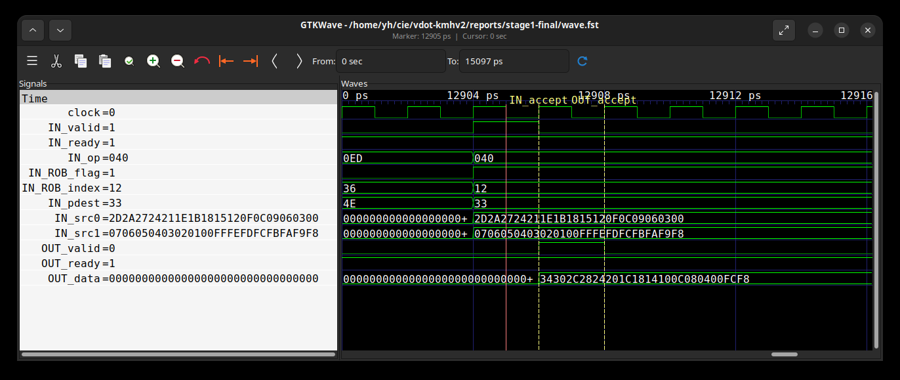
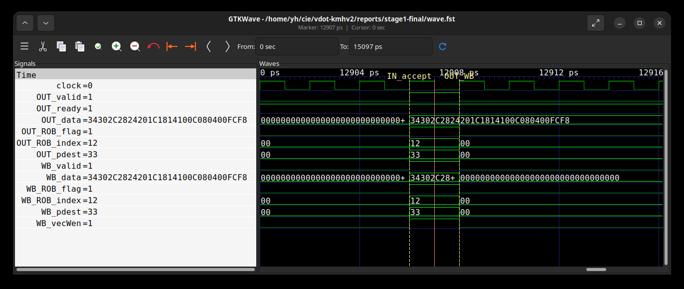
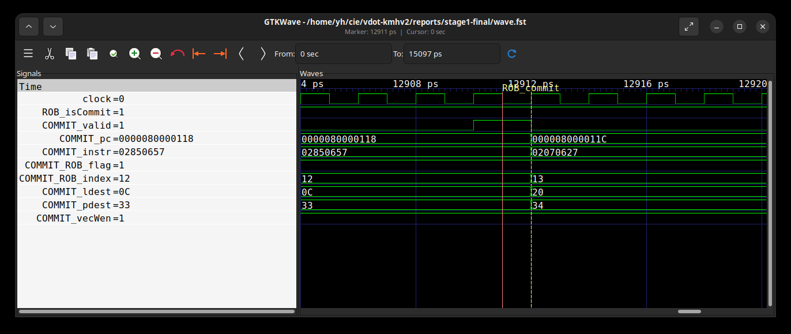

# 第一阶段文档

## 1.1 环境部署验证

### 平台与工具

采用香山昆明湖V2单核MinimalConfig，保留VLEN=128的向量实现。按官方开发流程完成源码准备、RTL生成、Verilator仿真器和NEMU参考库构建，再运行裸机向量加法程序。[R1]

| 项目 | 实际使用配置或版本 |
|---|---|
| 处理器配置 | 昆明湖V2，MinimalConfig，单核，VLEN=128 |
| Java / Mill | OpenJDK 20.0.2-internal / 0.12.3 |
| firtool | 1.62.1 |
| Verilator | 5.022，启用FST波形 |
| RISC-V GCC | 13.2.0，rv64gcv / lp64d |
| 差分参考 | NEMU reference动态库，Difftest启用 |

同机使用固定版本工具和下载缓存，核对版本与文件摘要后构建。源码、补丁、构建参数及依赖记录在独立操作日志中保存，复现命令见[环境部署](环境部署.md)。

### 实际验证输出

验证程序在香山整核RTL仿真器上执行，通过仿真UART输出问候及自检结果。原始日志的关键行如下：

```text
hello xiangshan, I am 全栈漏洞队, 10.104.2.73
VADD_PASS
Core  0's Commit SHA is: f1efc9c5ec, dirty: 0
The first instruction of core 0 has commited. Difftest enabled.
Core 0: HIT GOOD TRAP at pc = 0x80000054
Core-0 instrCnt = 847, cycleCnt = 7,493, IPC = 0.113039
```

团队标识为“全栈漏洞队”，10.104.2.73是构建该验证镜像时由hostname -I取得的本机IP，写入identity.h后由验证程序打印。程序的16项向量加法检查全部通过，原始进程退出码为0。下面分析的FST与本段输出来自同一次整核运行。

## 1.2 操作日志（单独提交）

原始仿真输出保存为“一阶段执行日志.log”，完整部署与操作记录通过“一阶段执行日志索引.md”和“1.2-部署操作日志/部署操作索引.md”查阅。日志包含源码准备、工具核验、NEMU构建、Chisel/firtool生成、模型编译、失败恢复和最终验收，原有225项记录及补充干净提交构建记录均保留原始文件和校验值。

## 1.3 向量加法指令执行过程

### 1.3.1 程序、输入与预期结果

目标指令PC=0x80000118，机器码0x02850657。配置SEW=8、VLEN=128、LMUL=1、VL=16、vstart=0、vm=1，tu/mu策略，16项均参与。[R5]

```text
8000010c: c0087057  vsetivli zero,16,e8,m1,tu,mu
80000110: 02088407  vle8.v v8,(a7)
80000114: 02060507  vle8.v v10,(a2)
80000118: 02850657  vadd.vv v12,v8,v10
8000011c: 02070627  vse8.v v12,(a4)
```

数组a[i]=i-8载入v8，b[i]=3*i载入v10，期望v12[i]=4*i-8。元素0至15的实测值依次为：-8、-4、0、4、8、12、16、20、24、28、32、36、40、44、48、52。完整128位结果为0x34302c2824201c1814100c080400fcf8；最右字节0xf8是元素0。

汇编操作数顺序为vd,vs2,vs1，所以本例vs2=v8、vs1=v10。执行单元src0=v10，src1=v8；两源原始128位数据已按16个字节逐项核对。C程序把v12存回内存后逐项断言，再输出VADD_PASS。

### 1.3.2 从原始波形关联同一条动态指令

FST时间刻度为1ps，以下在backend.clock上升沿之前采样；edge是捕获窗口内的上升沿编号。用PC、ROB标识和物理目的寄存器关联最终完成提交的同一条动态指令。

| 观察事件 | 边沿 | 相对译码 | 对应接口 |
|---|---:|---:|---|
| 译码接收 | 6425 | 0 | inner_ctrlBlock.decode.io_in_0 |
| 重命名输出接收 | 6427 | 2 | inner_ctrlBlock.rename.io_out_0 |
| 调度输出接收 | 6450 | 25 | inner_vfScheduler.io_toDataPathAfterDelay_1_0 |
| FU输入接收 | 6453 | 28 | inner_vfExuBlock.exus_2.VialuFix |
| FU结果握手 | 6454 | 29 | inner_vfExuBlock.exus_2.VialuFix |
| 控制侧写回有效 | 6454 | 29 | inner_wbDataPath.io_toCtrlBlock_writeback_15 |
| 物理向量寄存器写入 | 6454 | 29 | inner_wbDataPath.io_toVfPreg_1 |
| ROB提交有效 | 6456 | 31 | inner_ctrlBlock.rob.commit_0 |

接口根路径为TOP.SimTop.cpu.l_soc.core_with_l2.core.backend。6427分配ROB=(flag=1,value=18)、物理目的P51、逻辑目的v12，后续事件沿此动态身份关联。

同一PC还曾在1502、6023、6364出现；早先6366也分配过P51，但ROB=(0,6)。因此同时使用PC、ROB分配至复用的动态区间和物理目的，不能只按PC或P51拼接。FU叶级身份从同周期父执行单元回绑；物理寄存器写口自身没有ROB，需在该动态区间核对P51与完整结果，再以独立提交事件收尾。

### 1.3.3 真实波形截图与分析

以下三图为GTKWave直接读取本次FST的窗口截图。IN、OUT来自VialuFix及父执行单元，WB来自控制侧writeback_15，COMMIT来自ROB提交槽0。数值以十六进制显示；红色游标放在黄色命名采样沿之前。

#### 图1：操作数进入向量整数执行单元



取值游标12905位于输入采样沿12906之前。IN_valid=1、IN_ready=1、IN_op=0x40，接收向量加法。ROB_flag=1、ROB_index=0x12、pdest=0x33，即ROB=(1,18)、P51。两个128位源按8位拆分后分别对应v10和v8中的16项输入。

#### 图2：结果产生并进入写回通路



取值游标12907位于输出采样沿12908之前。OUT_valid=1、OUT_ready=1，OUT_data为0x34302c2824201c1814100c080400fcf8。WB_valid与WB_vecWen有效，写回完整数据、ROB=(1,18)和P51均与执行输出一致。从输入第6453沿到输出第6454沿，功能单元延迟为1拍。

#### 图3：同一条向量加法指令完成提交



取值游标12911位于提交采样沿12912之前。ROB_isCommit、COMMIT_valid和COMMIT_vecWen有效，PC=0x80000118、指令字0x02850657、逻辑目的0x0c即v12。ROB=(1,18)、P51与输入和写回对应，确认同一条动态指令完成架构提交。

### 1.3.4 逐阶段解释

译码：6425时目标PC/机器码与valid、ready共同有效，接收vadd.vv。随后译码信息选择现有向量整数ALU，op=64、vecwen=1、uop=0。未把更早的同PC事件自动视为最终提交实例。

重命名：6427时逻辑v12映射到新物理P51，并分配ROB=(1,18)。寄存器重命名提供后续源目的身份，维护推测映射和回滚所需信息；本次具体映射以实测为准。[R2]

调度与读源：6450发生向量调度输出握手，6453同一身份到达执行单元。现有DataPath及旁路路径负责形成操作数；此时src0、src1与数组一致，src4=16。重命名到调度相隔23拍。[R3]

执行：已有VIAluFix把128位数据拆入64位运算模块，按SEW执行同宽逐元素加法。固定源码VialuCfg的CertainLatency(1)与本次6453输入、6454结果的1拍相符。该观察属于vadd，不混用vdot的2拍结果。[R6][R7]

写回与提交：写回更新物理目的P51并向控制侧报告完成；ROB随后按程序顺序及异常约束提交。两处分别由图2、图3的有效信号和同一动态身份确认。[R4]

本次decode到commit为31拍，其中FU输入到输出为1拍。两者测量边界不同。原始FST、825项信号清单、事件JSON、目标事件CSV及反汇编在本地保留；波形截图和摘要用于核对本节分析。

## 参考资料

- [R1] [香山官方开发环境](https://docs.xiangshan.cc/zh-cn/latest/tools/xsenv/)
- [R2] [昆明湖V2重命名设计](https://docs.xiangshan.cc/projects/design/zh-cn/kunminghu-v2/backend/CtrlBlock/Rename/)
- [R3] [昆明湖V2 DataPath设计](https://docs.xiangshan.cc/projects/design/zh-cn/kunminghu-v2/backend/DataPath/DataPath/)
- [R4] [昆明湖V2 ROB设计](https://docs.xiangshan.cc/projects/design/zh-cn/kunminghu-v2/backend/CtrlBlock/Rob/)
- [R5] [RISC-V Vector 1.0，同宽整数加法](https://github.com/riscvarchive/riscv-v-spec/blob/v1.0/v-spec.adoc)
- [R6] [固定源码VIAluFix.scala](https://github.com/OpenXiangShan/XiangShan/blob/7b16188f7f18a97be69c9b1a2dae8a446eec3b47/src/main/scala/xiangshan/backend/fu/wrapper/VIAluFix.scala)
- [R7] [固定源码FuConfig.scala](https://github.com/OpenXiangShan/XiangShan/blob/7b16188f7f18a97be69c9b1a2dae8a446eec3b47/src/main/scala/xiangshan/backend/fu/FuConfig.scala)
