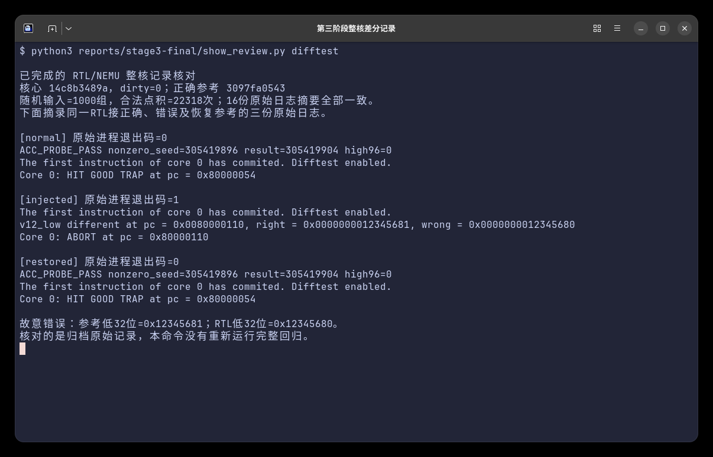
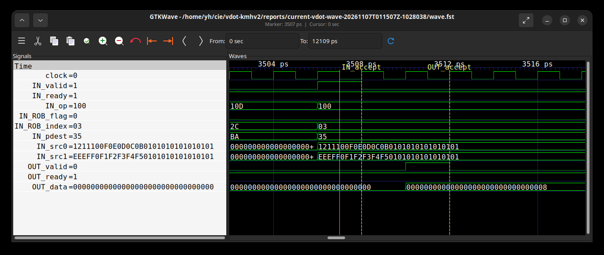
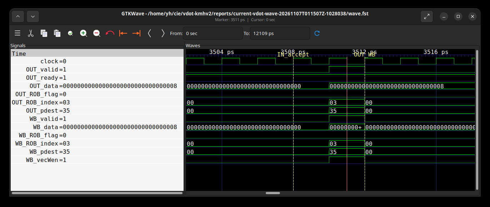
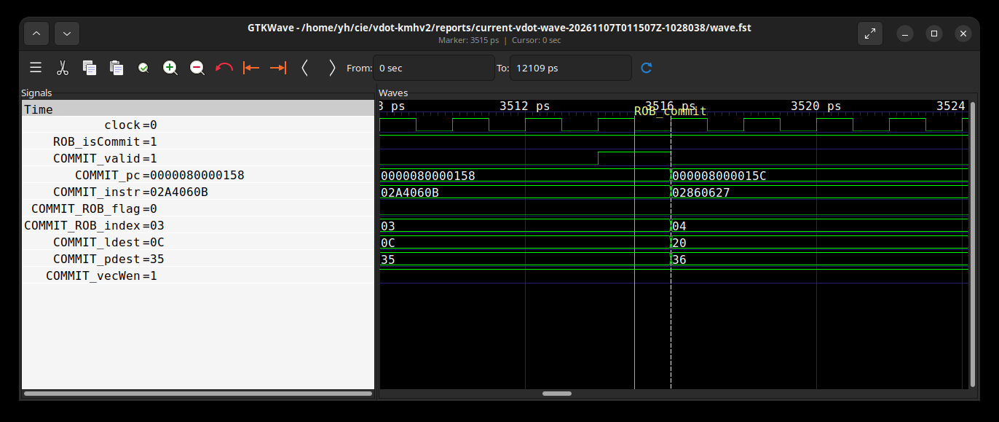
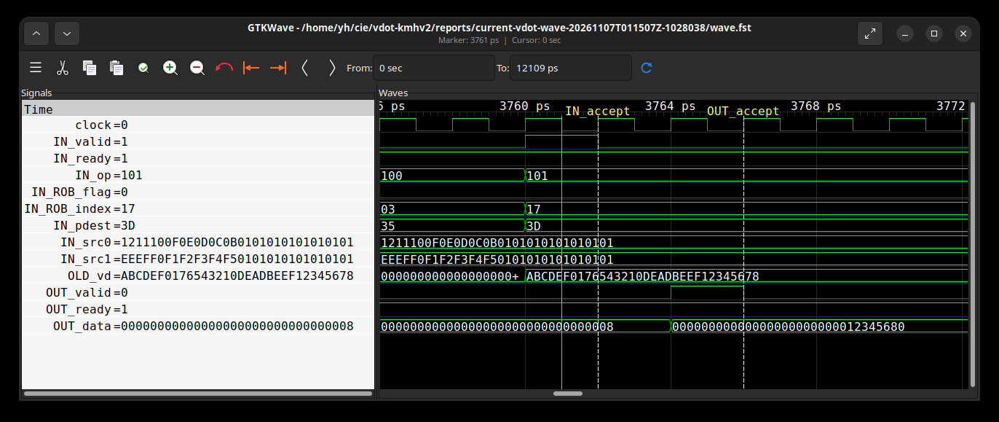
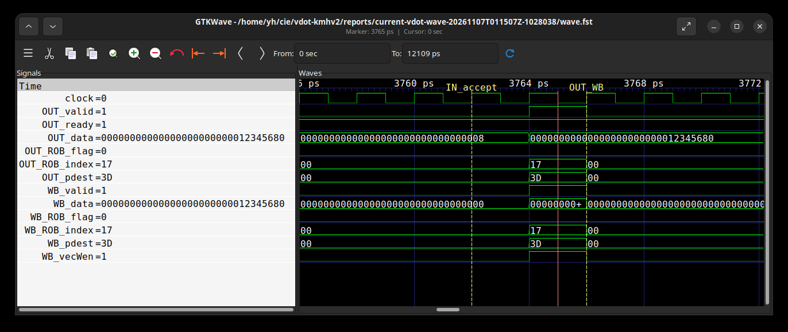
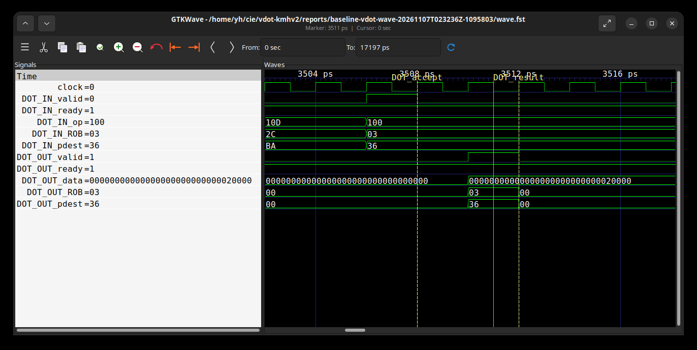
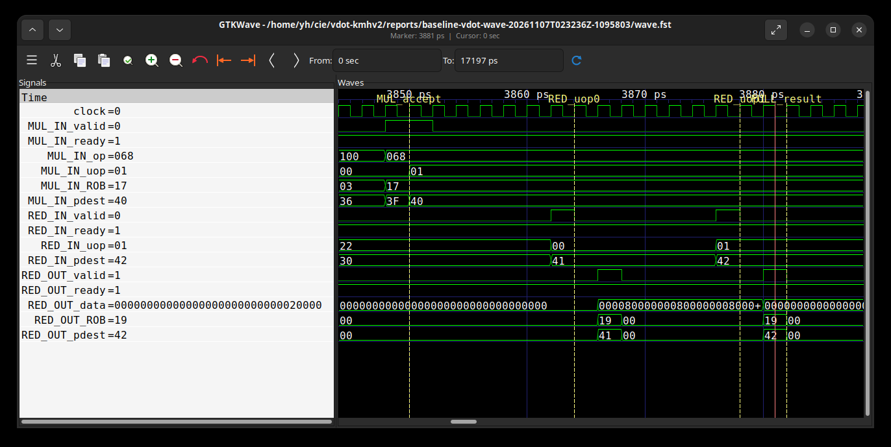
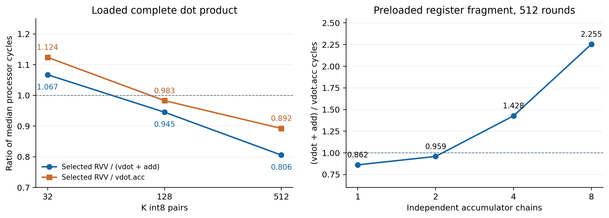
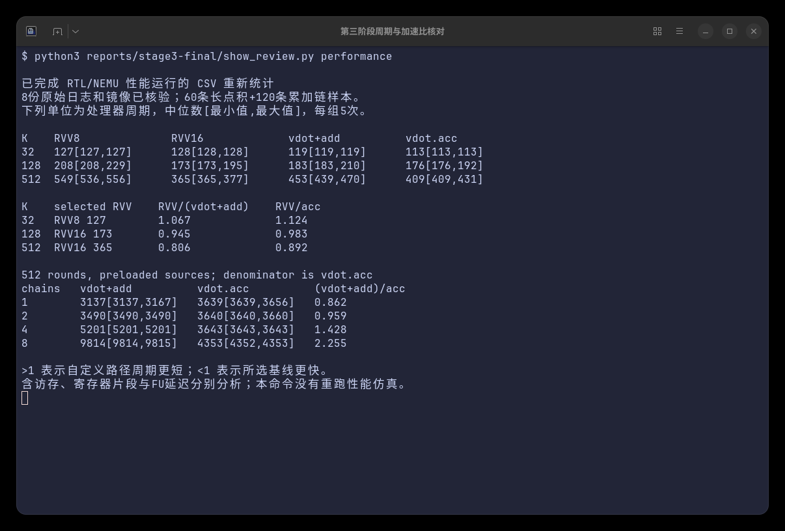

# 第三阶段文档

## 3.1.1 NEMU指令扩展

NEMU基于固定提交d772a9d9e06f663d529bd1c6518480c1ee59ded2扩展。两条自定义指令使用与RTL相同的custom-0编码；软件循环独立计算低8对有符号int8乘积，全部源值读取后才写目标。累加使用uint32_t运算实现32位回绕。

[扩展补丁](../patches/nemu.patch)修改五处实际源码，编译得到独立NEMU及Difftest参考动态库。

| 文件 | 新增职责 |
|---|---|
| isa-all-instr.h | 注册vdot与vdot_acc执行入口 |
| instr/decode.c | 识别custom-0中的两种编码 |
| instr/rvv/vcompute.h | 独立计算、完整目标写入和向量状态更新 |
| local-include/trapinfo.h | 保存晚期配置异常的一次性内部标记 |
| system/intr.c | 按异常检查顺序形成mtval |

合法指令执行路径的核心运算为：

```c
const uint32_t old_accumulator = accumulate
    ? (uint32_t)vreg_l(id_dest->reg, 0) : 0;
int32_t result = 0;
for (int i = 0; i < 8; ++i) {
  result += (int32_t)(int8_t)vreg_b(id_src1->reg, i)
          * (int32_t)(int8_t)vreg_b(id_src2->reg, i);
}
vreg_l(id_dest->reg, 0) = old_accumulator + (uint32_t)result;
vreg_l(id_dest->reg, 1) = 0;
```

普通vdot选择累加初值0。先读全部源再写目标，因此源目标重叠仍保留原输入。32位无符号加法按模2^32回绕，写入低64位槽时自动补零；另一64位槽明确清零。实现随后清零vstart并更新向量脏状态。参考运算使用软件循环，与RTL的压缩树和前缀加法器分别实现。


早期译码非法检查覆盖向量状态、vill、非零vstart、整数LMUL寄存器对齐和masked目的v0；xtval为指令字。其余不支持配置在功能单元报告cause=2、xtval=0。NEMU镜像相同顺序。

## 3.1.2 RTL与NEMU协同仿真

Difftest比较向量寄存器和向量CSR。原始日志保留模型、工作负载、参考库、flash、命令和退出码。

| 测试 | 内容 | 结果入口 |
|---|---|---|
| 功能随机 | 1000组唯一随机、6组定向、6种关系、TA/TU，共22318次合法点积 | [完整差分](data/验证摘要.json) |
| 流水 | 1664条累加指令、生产者、别名和分支 | [流水记录](data/验证摘要.json) |
| 边界寄存器 | v0/v31及6种关系、两种尾策略 | [寄存器记录](data/验证摘要.json) |
| 交叉异常 | 原vdot和累加版各24种配置 | [异常记录](data/验证摘要.json) |
| 故障与恢复 | 同一RTL分别接正确、错误、恢复参考库 | [差分反例](data/验证摘要.json) |

48例异常测试在旧参考中检出20例mtval错误，修正前置对齐和v0重叠检查后全部通过。初始参考、修正参考及每次实验的摘要分别保存在数据中。

### 归档差分结果与反例核对



终端直接读取已经完成的原始记录。16份随机回归日志的摘要与公开索引一致；错误参考一轮在v12低32位检出不一致并中止，恢复参考后正常结束。日志中的right是参考模型值，本次故意改为0x12345681；wrong标签对应RTL实际值0x12345680。该反例验证目标向量状态确实参与比较。三轮均使用同一RTL和工作负载，仅切换参考库。


### 当前整核波形与点积累加执行过程

本节波形来自当前提前压缩与前缀加法共享实现。带波形模型与无波形性能模型使用逐字节相同的整核生成RTL，两种构建分别用于信号分析与性能采样。

[波形程序](../examples/vdot_wave.c)分别执行一次vdot.vv和vdot.acc。两源低8项均为1，高64位设置互不相同的无关数据；两次执行前均把旧目标完整加载为0xabcdef0176543210deadbeef12345678。普通点积期望8，累加版期望0x12345678+8=0x12345680，两者高96位均清零。

程序检查完整128位结果，实际RTL/NEMU差分通过，核心dirty标志为0，退出码为0，并输出：

```text
CURRENT_TRACE_PASS dot_low32=8 acc_low32=305419904 high96=0 cases=2
```

以下六图为GTKWave直接读取本次真实FST的窗口截图。IN和OUT表示Vimac及其父执行单元的输入、输出，OLD_vd是第三源，WB表示writeback_13，COMMIT表示ROB提交槽0。数据和寄存器编号以十六进制显示，红色取值游标放在命名上升沿标记之前。

#### 图1：当前vdot.vv输入接收



取值游标3507位于输入采样沿3508之前。IN_valid=1、IN_ready=1、IN_op=0x100，表示接收普通点积。IN_ROB_flag=0、IN_ROB_index=0x03、IN_pdest=0x35，对应ROB=(0,3)、P53。两源低64位均为0x0101010101010101，高64位不同；预期只计算低8对元素，结果为8。

#### 图2：当前vdot.vv输出与写回



取值游标3511位于输出采样沿3512之前。OUT_valid与OUT_ready均为1，完整OUT_data为0x00000000000000000000000000000008。输出的ROB索引0x03和目的0x35与图1一致。WB_valid、WB_vecWen同时有效，WB_data和指令身份相同，结果进入控制侧写回通路。

#### 图3：当前vdot.vv提交



取值游标3515位于提交采样沿3516之前。ROB_isCommit和COMMIT_valid均为1，PC=0x80000158，指令字0x02a4060b；ROB=(0,3)、P53保持一致，逻辑目的0x0c对应v12。至此，同一条动态指令的接收、结果、写回和提交均有对应事件。

#### 图4：当前vdot.acc读取旧累加器



取值游标3761位于输入采样沿3762之前。IN_valid和IN_ready均为1，IN_op=0x101选择累加变体。ROB索引0x17对应十进制23，目的0x3d对应P61。OLD_vd显示完整旧目标0xabcdef0176543210deadbeef12345678；参与累加的是低32位0x12345678。

本程序使用ta/ma策略，第三源仍读取非零旧目标。这与累加译码保留SrcType.vp及isDependOldVd的实现一致。普通点积和累加版使用相同源数据，但前者忽略旧目标，后者保留真实累加依赖。

#### 图5：当前vdot.acc结果与写回



取值游标3765位于输出采样沿3766之前。OUT_valid、OUT_ready、WB_valid和WB_vecWen均为1，OUT_data与WB_data均为0x00000000000000000000000012345680。输出和写回的ROB=(0,23)、P61相同。旧目标高96位原本非零，此时已经清零，符合结果布局要求。

#### 图6：当前vdot.acc提交


取值游标3769位于提交采样沿3770之前。ROB_isCommit、COMMIT_valid、COMMIT_vecWen有效，PC=0x80000196，指令字0x06a4060b。ROB索引0x17、物理目的0x3d、逻辑目的0x0c与输入和输出对应，确认累加指令完成架构提交。

#### 同一动态指令的时序关联

| 指令 | FU输入上升沿 | 输出/写回上升沿 | ROB提交上升沿 | FU延迟，拍 |
|---|---:|---:|---:|---:|
| vdot.vv | 1754 | 1756 | 1758 | 2 |
| vdot.acc | 1881 | 1883 | 1885 | 2 |

表中编号是捕获窗口内的backend.clock上升沿序号。相邻上升沿间隔两个FST时间步，普通点积输入3508到输出3512、累加输入3762到输出3766均经过两拍。本例两条指令的输出到提交另相隔两拍；这是本程序的观察值，不能推广为所有指令的固定提交延迟。

FU输入的ROB身份从同周期父执行单元回绑。物理寄存器写口本身没有ROB，分析脚本在同一动态区间内核对目的、完整数据及对应写回周期，避免仅凭相同PC或目的寄存器拼接事件。数据只在valid/ready共同有效时计入一次接收，valid无效时保持的数据不代表新结果。

同一探针在无波形和带波形构建中均执行925条指令、8572周期，结果一致。这项对照用于检查执行一致性；性能结论仍取原无波形模型的180条基准样本。FST的ps刻度用于仿真事件排序，实际电路时序由独立STA评估。

接口根路径为TOP.SimTop.cpu.l_soc.core_with_l2.core.backend，FU路径为inner_vfExuBlock.exus.Vimac。运行、FST、事件及截图的摘要保存在[验证摘要](data/验证摘要.json)，采集和分析命令见[复现说明](复现说明.md)。原始FST和完整运行日志在本地保留。

## 3.2 等价RVV基线功能实现

### 3.2.1 八项点积的标准向量指令组合

[基准程序](../examples/acc_benchmark.c)包含普通vdot、RVV8、RVV16和vdot.acc四条路径。它们从同一组连续int8数据计算完整K维点积，最终只存一次16字节结果，低32位为点积，高96位清零。普通vdot每次计算8对，跨块由软件显式相加，保持赛题规定的指令语义。

RVV8使用有符号扩宽乘法vwmul.vv得到int16乘积，再用扩宽归约vwredsum.vs累加到int32。以下为实际内核中一组8项的主要操作；完整循环每次展开四组，共处理32对。

```asm
# v24..v27 are initialized to four zero int32 lanes
vsetivli zero,8,e8,m1,ta,ma
vle8.v v0,(a)
vle8.v v1,(b)
vwmul.vv v8,v0,v1
# load and multiply the other three groups
vsetivli zero,8,e16,m1,tu,mu
vwredsum.vs v24,v8,v24
# reduce the other groups into v25..v27
vsetivli zero,4,e32,m1,tu,mu
vadd.vv v24,v24,v25
vadd.vv v26,v26,v27
vadd.vv v24,v24,v26
vs1r.v v24,(out)
```

代码中的a、b、out代表实际内联汇编的地址操作数。累加器初始化包含在完整内核计时内，tu策略保留已经清零的其余目标元素。扩宽归约直接产生int32和，避免八项边界值在int16中溢出。

### 3.2.2 较强的RVV16候选与等价性

另一候选每次加载16项，vwmul.vv仍生成int16乘积，再用vwadd.wv扩宽加到int32通道中，最后只做一次vredsum.vs。主要操作如下，完整32项循环包含两组加载与乘法：

```asm
vsetivli zero,16,e8,m1,ta,ma
vle8.v v0,(a)
vle8.v v1,(b)
vwmul.vv v8,v0,v1
# second group produces v12
vsetivli zero,16,e16,m2,tu,mu
vwadd.wv v16,v16,v8
vwadd.wv v20,v20,v12
# after all K elements
vsetivli zero,16,e32,m4,tu,mu
vadd.vv v16,v16,v20
vredsum.vs v24,v16,v28
vs1r.v v24,(out)
```

初始化先把v16、v20及归约初值清零。测试K≤512时int32中间累加不会溢出。每种方案均由客体程序逐个检查完整128位结果，且启用RTL/NEMU差分。

基线正确性包含K=32和512、正数、负数及四类边界，共12组输入、四条路径、48次执行。客体对每次结果作断言，原始UART保留顺序校验和1060332573，宿主独立重算后相同。正式随机数据中的实测结果如下，四条路径分别与独立标量参考一致。

| K | 标量参考 | 普通vdot | RVV8 | RVV16 | vdot.acc |
| 32 | 46348 | 46348 | 46348 | 46348 | 46348 |
| 128 | 12398 | 12398 | 12398 | 12398 | 12398 |
| 512 | -38688 | -38688 | -38688 | -38688 | -38688 |

性能基线先分别求RVV8与RVV16的五次测量中位数，再选较快者。源数据、完整结果布局和计时边界一致；不以较慢候选作为主基线。

## 3.3 延迟与加速比分析

### 3.3.1 测量边界与原始数据

| 指标 | 起止边界 | 本报告的用途 |
|---|---|---|
| 功能单元延迟 | FU输入握手至对应输出握手 | 当前vdot.vv与vdot.acc均实测为2拍 |
| 含访存完整内核延迟 | 初始化之前至完整结果存储后的计时终点 | 比较RVV组合与自定义方案完成同一K维点积的周期 |
| 寄存器片段周期 | 源预加载后的计时起点至循环与末尾存储结束 | 分析普通点积加显式加法与融合累加的效果 |

计时边界执行fence rw,rw并读取cycle CSR。完整内核计时包括向量初始化、必要配置、加载、循环、跨块累加、结果整理、16字节存储和结束fence；标量参考计算与输出哨兵初始化在计时外。每组独立预热一次，正式重复5次，性能采样关闭波形并保留差分。

共有60条长点积和120条累加链样本。8份整核性能分片的原始日志、镜像及退出码已核验；反汇编确认结果存储位于循环后、结束cycle读取前，输出地址寄存器未与循环修改的地址或计数器重叠。各分片输入按64字节对齐、两源间距512字节，同名函数入口PC一致；输入基址可能不同，各自预热。

本报告定义：加速比=等价基线中位周期/自定义方案中位周期。大于1表示自定义方案完成该片段更快，小于1表示基线更快。该周期比与前面的两拍FU延迟分别列示。

### 3.3.2 相同八项点积的FST执行跨度

[专用对照程序](../examples/vdot_baseline_wave.c)在同一当前整核模型中分别执行普通vdot与RVV8组合。两源低8项均为-128，标量参考为131072；源高64位为无关值。两条路径都检查完整128位结果，并启用NEMU差分：

```text
BASELINE_WAVE_PASS expected=131072 vdot=131072 rvv=131072 high96=0
```

两条路径的源加载和目标清零均在观察窗口之外，RVV额外预置零归约初值。RVV先在SEW=8、LMUL=1、VL=8下执行vwmul.vv，再切换到SEW=16、LMUL=1、VL=8执行vwredsum.vs。这里测量首次算术FU输入握手至最终完整结果的FU输出握手，包含窗口内的微操作执行与调度间隔。

#### 图7：同一边界输入下的普通vdot



输入沿3508对应第1754个backend.clock上升沿，输出沿3512对应第1756沿，经过2拍。输出游标3511处完整结果为0x00000000000000000000000000020000，ROB=(0,3)、物理目的0x36即P54与输入对应。

#### 图8：RVV乘法与归约的真实执行跨度



MUL_accept标记3850对应第1925沿，FULL_result标记3882对应第1941沿，间隔16拍。vwmul的ROB索引0x17即23，归约的ROB索引0x19即25。完整操作分解如下：

| 操作 | FU输入沿 | FU输出沿 | 物理目的 | 作用 |
|---|---:|---:|---|---|
| vdot | 1754 | 1756 | P54 | 完整32位和，结果131072 |
| vwmul微操作0 | 1925 | 1927 | P63 | 低8项int16乘积 |
| vwmul微操作1 | 1926 | 1928 | P64 | 加宽寄存器组的尾部处理 |
| vwredsum微操作0 | 1932 | 1934 | P65 | 归约中间结果 |
| vwredsum微操作1 | 1939 | 1941 | P66 | v12的完整结果131072 |

归约首个微操作使用内部逻辑目的32，第二个微操作写架构v12。ROB提交调试字段记录首个微操作的P65，最终v12结果写入P66；分析同时核对该ROB组内的重命名、微操作、写回及程序存回的128位结果，避免把内部中间值误作最终结果。

本次八项、m1组合的观测执行跨度比为16/2=8.000。该窗口排除了加载和预清零，不能把它直接当成完整内核或任意RVV实现的加速比。下面另外按完整K维内核的统一计时边界报告收益。

### 3.3.3 普通vdot.vv与RVV基线的主对比

下表单位为处理器周期，格式为中位数[最小值,最大值]。普通vdot路径包含完成完整K维点积所需的显式跨块加法。

| K | RVV8 | RVV16 | 选定基线 | 普通vdot加法 | 基线/vdot |
| 32 | 127[127,127] | 128[128,128] | RVV8，127 | 119[119,119] | 1.067 |
| 128 | 208[208,229] | 173[173,195] | RVV16，173 | 183[183,210] | 0.945 |
| 512 | 549[536,556] | 365[365,377] | RVV16，365 | 453[439,470] | 0.806 |

K=32时取较快RVV的127周期，普通vdot方案为119周期，加速比127/119=1.067。K=128和512时，较快RVV分别为173和365周期，普通vdot为183和453周期，周期比为0.945和0.806。

反汇编中，每32对输入的循环指令数依次为普通vdot路径28条、RVV8路径28条、RVV16路径16条、融合累加路径22条。RVV16每32对仅需4条向量加载，8项分块路径需要8条；同时把最终归约推迟到循环末尾。该静态结构说明长K下的配置、加载和归约开销差异，不能把两拍算术路径直接换算为完整内核收益。

### 3.3.4 累加融合与并行链扩展对比

vdot.acc是额外设计的累加变体，采用与普通点积共享的乘法、压缩及前缀加法路径。其完整内核对比继续使用同一较快RVV基线：

| K | 选定RVV基线 | vdot.acc中位周期及范围 | 基线/acc |
| 32 | 127 | 113[113,113] | 1.124 |
| 128 | 173 | 176[176,192] | 0.983 |
| 512 | 365 | 409[409,431] | 0.892 |

K=32时融合内核为113周期，127/113=1.124；K=128和512时RVV16仍更快。该结果与普通vdot的主对比独立列示。

寄存器片段另外预加载源和初值，比较普通vdot加显式e32加法与融合累加。独立链数1/2/4/8，循环轮数32/128/512，每组5次，共120条样本。下面为512轮结果：

| 独立链数 | 普通vdot加法 | vdot.acc | 普通路径/融合 |
| 1 | 3137[3137,3167] | 3639[3639,3656] | 0.862 |
| 2 | 3490[3490,3490] | 3640[3640,3660] | 0.959 |
| 4 | 5201[5201,5201] | 3643[3643,3643] | 1.428 |
| 8 | 9814[9814,9815] | 4353[4352,4353] | 2.255 |

单链普通路径的真实递推只经过显式加法，融合路径的递推经过点积指令，因此本次单链融合更慢。四条和八条独立链提供更多并行输入，融合路径的片段周期更短。2.255的分子是普通vdot加显式加法，不能写成相对RVV或完整模型的加速比。



左图两条线分别采用“较快RVV/普通vdot”和“较快RVV/融合累加”；右图采用“普通vdot加法/融合累加”。虚线1表示周期相同，所有点由逐次CSV的中位数重新计算。

### 3.3.5 周期统计的真实终端核对



该终端核对归档性能运行的原始摘要，并从CSV重新计算中位数、范围及周期比。它展示既有实测数据的复核结果，未把文档整理命令表述成新一轮性能仿真。

### 3.3.6 算术模块资源与时序

使用Nangate45 typical、1.10 V、25°C，ABC目标1000 ps，每个设计只映射一次，同一网表分别检查1/1.5/2.5 ns。输入/输出延迟100 ps、输入转换50 ps、负载5 fF、不确定度20 ps，理想时钟、零互连。包装器将两级使能绑定到公共enable，独立使能由功能测试覆盖。

| 算术结构 | 面积，Liberty属性单位 | 1.5 ns建立裕量，ns |
|---|---:|---:|
| 原两级点积 | 4944.408 | +0.351741 |
| 平衡归约后串累加 | 5431.188 | -0.561671 |
| CSA与普通最终加法 | 5733.896 | -0.220036 |
| CSA与前缀加法 | 5830.188 | -0.055645 |
| 提前压缩与前缀，单元输出 | 5608.344 | +0.100698 |
| 提前压缩与前缀，整核实际输出 | 5519.500 | +0.136429 |

提前压缩版在同轮单元对照中较未重定时前缀版减少3.805%面积，并使1.5 ns建立裕量转正。实际整核生成模块较原点积增加11.631%映射面积，159个触发器，1 ns仍有负建立裕量。评估范围为算术模块，未包含完整FU控制、端口和物理互连。

### 3.3.7 结论与适用范围

普通vdot完成赛题规定的8项有符号点积。直接八项FST探针中观测到RVV组合16拍、vdot 2拍；含访存短K完整内核取得1.067的周期比。较长K下，标准RVV16通过通道累加与末尾归约获得更低的总周期。累加融合进一步减少显式操作，但其收益取决于独立链数和真实递推路径。

数据支持的优化点是共享点积累加路径、普通点积消除旧目标假依赖、累加变体保留真实旧目标，以及提前压缩对两级时序的改善。性能结论限于已列输入、配置和测量范围；算术模块时序与面积结果另按其独立约束解释。

## 数据与复现

[NEMU扩展补丁](../patches/nemu.patch)、[基准程序](../examples/acc_benchmark.c)、[长点积逐次周期](data/长点积周期.csv)、[累加链逐次周期](data/累加链周期.csv)、[资源时序表](data/资源时序.csv)和[验证摘要](data/验证摘要.json)提供源码与公开结果。原始FST、完整日志、镜像和反汇编在本地保留，构建、差分、波形及性能脚本入口见[复现说明](复现说明.md)。
