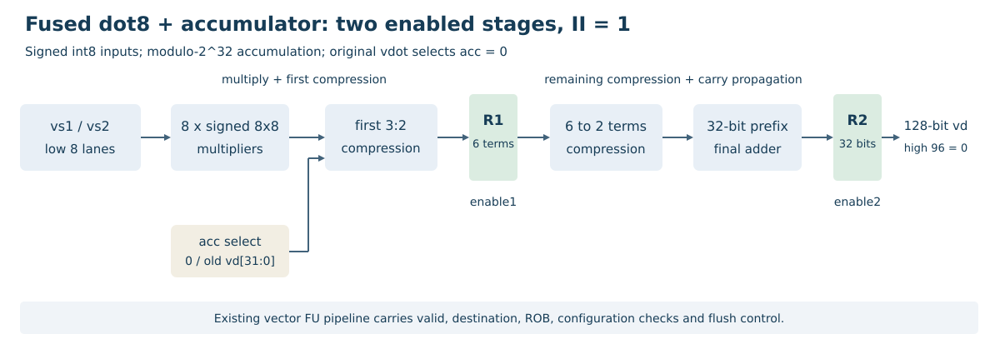

# 第二阶段文档

## 2.1 vdot.vv设计文档

### 2.1.1 平台与指令语义

平台为香山昆明湖V2，固定上游提交7b16188f7f18a97be69c9b1a2dae8a446eec3b47，单核MinimalConfig，VLEN=128。

```text
partial = sum(int8(vs1[i]) * int8(vs2[i]), i=0..7)
vdot.vv:  vd[31:0] = uint32(partial)
vdot.acc: vd[31:0] = (old_vd[31:0] + uint32(partial)) mod 2^32
两种指令: vd[127:32] = 0
```

支持SEW=8、LMUL=1、VL=8、vstart=0、vm=1。两源高64位不参与计算，vta/vma不改变完整结果布局。全部源值和旧累加值读取后再写目标，支持源目标重叠。

八项点积的精确范围为[-130048,131072]，19位有符号数足够表示。32位结果便于在int8全连接或GEMV中跨K维分块累加；非零量化零点的修正、偏置和重量化由调用程序完成。低8项遵循赛题语义图，结果位宽和最小支持域采用本项目[契约](../contract.json)；扩展累加契约见[vdot.acc](../configs/vdot-acc.json)。

### 2.1.2 编码

| 字段 | vdot.vv | vdot.acc |
|---|---|---|
| funct6[31:26] | 000000 | 000001 |
| vm[25] | 1 | 1 |
| vs2[24:20]、vs1[19:15] | 源向量寄存器 | 源向量寄存器 |
| funct3[14:12] | 000 | 000 |
| vd[11:7] | 目的寄存器 | 目的寄存器及旧累加器 |
| opcode[6:0] | custom-0，0001011 | custom-0，0001011 |
| mask | 0xfc00707f | 0xfc00707f |
| match | 0x0000000b | 0x0400000b |
| vd12、vs1=v8、vs2=v10 | 0x02a4060b | 0x06a4060b |

测试使用`.word`发射，无需修改编译器助记符表。内部操作类型为0x100和0x101。

### 2.1.3 向量通路接入

VecDecoder将两种指令送到已有FuType.vimac，RiscvInst将其识别为向量算术指令。操作数读取、有效位、目的物理寄存器、ROB标签、写回和提交沿用既有向量通路。执行槽位与标准向量乘法共享。

普通vdot的第三源为SrcType.no，消除旧目标假依赖。累加变体的第三源为SrcType.vp，DecodeUnit另设isDependOldVd，使TA和完整覆盖条件下的依赖消除逻辑保留真实旧累加值。

### 2.1.4 两级共享数据通路



第一级完成8路有符号8×8乘法、32位符号扩展及首层3:2压缩，寄存6项和/进位。普通点积在这一层取累加输入0，累加指令取旧vd低32位。

第二级将6项压缩到2项，经32位并行前缀加法器生成结果，寄存后在高96位补零。压缩移位和加法按模2^32处理；负乘积先作符号扩展，因此普通点积仍得到正确的32位补码。

两个寄存阶段分别受现有regEnable(1)、regEnable(2)控制，有效位和标签随向量流水推进。独立数据通路测试检查两个有效使能边沿的延迟、连续一拍接收，以及两级分别暂停时的数据保持。

同约束下，提前首层压缩使单元生成形式的面积从5830.188降至5608.344，1.5 ns建立裕量从-0.055645 ns转为+0.100698 ns。整核生成器优化后的实际模块为5519.500、+0.136429 ns。测量条件与原始记录见[资源数据](三阶段性能分析文档.md)。这些是算术模块的布局前结果。

### 2.1.5 异常与NEMU

向量译码先检查向量状态、vill、非零vstart、整数LMUL源/目的寄存器对齐，以及vm=0时目的v0重叠。这些早期非法指令的xtval为指令字。通过译码后，功能单元对其余超出支持域的配置报告cause=2、xtval=0；目标和vstart保持原值。

NEMU镜像相同检查顺序。合法运算使用独立的软件循环，先读全部源值及旧目标，再以uint32_t加法回绕，写低64位槽时高32位为零，另一64位槽写零。一次性非架构标记仅用于晚期配置异常的xtval选择。

48例交叉异常测试覆盖两种指令、整数/分数LMUL、mask/v0、vill和vstart。修正前参考模型有20例mtval差异，修正后同一RTL与参考模型全部通过。[异常记录](data/验证摘要.json)

## 2.2 RTL实现与验证入口

| 交付文件 | 内容 |
|---|---|
| src/Vdot.scala | 普通点积、累加融合和两级共享算术数据通路 |
| patches/xiangshan.patch | 相对固定上游的译码、读源依赖与VIMacU接入修改 |
| rtl/VdotAccRetimedDatapath.sv | 当前整核构建实际生成的共享算术模块 |
| rtl/VIMacU.sv | 同次生成的执行单元包装器 |
| patches/nemu.patch | 两种指令的独立软件计算和异常处理 |

Chisel实现、生成模块和集成补丁的摘要由configs/source-manifest.json核对。RTL生成使用固定昆明湖V2源码，运行测试使用同一共享数据通路。

VIMacU中的关键接入语句如下。实例化参数选择提前压缩和前缀加法的共享路径；源操作数、两级使能和结果选择均连接既有向量执行通路。

```scala
private val dot = Module(new VdotAccDatapath(
  useCarrySave = true, usePrefix = true,
  retimeFirstCompression = true))
dot.io.vs1 := vs1
dot.io.vs2 := vs2
dot.io.acc := Mux(fuOpType === VdotEncoding.accOp,
                 oldVd(31, 0), 0.U(32.W))
dot.io.enable1 := regEnable(1)
dot.io.enable2 := regEnable(2)
io.out.bits.res.data := Mux(outIsDot, dot.io.result, mgu.io.out.vd)
```

outIsDot由随流水推进的操作类型选择，普通点积与累加变体均选取共享结果；标准向量乘法继续使用既有结果路径。原平衡树类用于基线对照。


[整核波形程序](../examples/vdot_wave.c)为两种指令加载相同的源数据和非零旧目标。普通点积检查结果8，累加版检查0x12345678+8=0x12345680；两者都检查完整128位目标，高96位必须为0。源高64位和旧目标高96位设置无关值，用于区分有效参与项和清零要求。执行脚本为scripts/run_vdot_wave.py，波形关联脚本为scripts/analyze_vdot_wave.py。

算术单元测试直接编译src/Vdot.scala，检查定向输入、随机输入及两级分别暂停时的数据保持。整核验证另外检查译码、读源依赖、写回、异常和提交，单独算术测试不能替代整核结果。

[功能程序](../examples/acc_validation.c)覆盖1000组唯一随机输入、6组边界、6种寄存器关系及TA/TU，其中包含2012次普通vdot对照。另有累加流水、v0/v31、错误参考检出及恢复测试。

[基准程序](../examples/acc_benchmark.c)比较普通vdot加显式加法、两条RVV序列和融合累加，分别测量含访存长点积及1/2/4/8条独立链。报告列出五次重复的中位数和范围；RVV分子取两种候选较快的中位数。完整结果见[性能报告](三阶段性能分析文档.md)。

原平衡归约算术模块保存在[基线目录](../rtl/baseline/README.md)，用于资源对照。

## 2.3 基础功能测试

### 2.3.1 正数点积测试

[基础程序](../examples/vdot_basic.c)逐例加载两源及非零旧目标，检查完整128位结果。源高64位为无关数据。

正数用例的两源低8项均为1，期望结果为8。实际低32位为0x00000008，高96位为0，与预期一致。

### 2.3.2 负数点积测试

两源低8项分别为-1和1，期望结果为-8。实际完整128位为0x000000000000000000000000fffffff8。负数仅在低32位保存补码，高96位清零。

### 2.3.3 边界值与完整结果检查

| 用例 | 两源低8项 | 期望结果 | 完整128位结果 |
|---|---|---:|---|
| 正数 | 1 / 1 | 8 | 00000000000000000000000000000008 |
| 负数 | -1 / 1 | -8 | 000000000000000000000000fffffff8 |
| 最小值乘最小值 | -128 / -128 | 131072 | 00000000000000000000000000020000 |
| 最小值乘最大值 | -128 / 127 | -130048 | 000000000000000000000000fffe0400 |
| 最大值乘最大值 | 127 / 127 | 129032 | 0000000000000000000000000001f808 |
| 零 | 0 / -128 | 0 | 00000000000000000000000000000000 |

[当前整核运行记录](data/基础测试.csv)中的六项实际结果与上表一致，Difftest启用，GOOD TRAP、原始退出0。

正边界131072检查超过18位有符号正上限的情况，高96位均检查为0。

### 2.3.4 当前整核实测输出

当前共享实现的六项基础程序输出如下，实际退出码为0，同时启用RTL/NEMU差分并到达GOOD TRAP。

```text
BASIC_CASE name=positive a=1 b=1 count=8 expected=8 actual=8 vd=00000000000000000000000000000008 PASS
BASIC_CASE name=negative a=-1 b=1 count=8 expected=-8 actual=-8 vd=000000000000000000000000fffffff8 PASS
BASIC_CASE name=boundary_min_min a=-128 b=-128 count=8 expected=131072 actual=131072 vd=00000000000000000000000000020000 PASS
BASIC_CASE name=boundary_min_max a=-128 b=127 count=8 expected=-130048 actual=-130048 vd=000000000000000000000000fffe0400 PASS
BASIC_CASE name=boundary_max_max a=127 b=127 count=8 expected=129032 actual=129032 vd=0000000000000000000000000001f808 PASS
BASIC_CASE name=boundary_zero a=0 b=-128 count=8 expected=0 actual=0 vd=00000000000000000000000000000000 PASS
VDOT_BASIC_PASS directed_cases=6
```

逐例输入与结果见[基础测试CSV](data/基础测试.csv)。完整命令、镜像、模型摘要、原始日志和cases.json在本地保留。

### 2.3.5 累加扩展及回归覆盖

当前共享路径的[整核回归](data/验证摘要.json)覆盖6组定向和1000组唯一随机输入，每组使用6种寄存器关系及两种尾策略，包含2012次普通vdot对照。累加版另外覆盖非零初值、正负回绕、单/四累加链和源高位不相关检查。

[流水测试](data/验证摘要.json)执行1664条累加指令，覆盖独立目的、vadd生产者、源目标重叠链及分支两种方向；[边界寄存器测试](data/验证摘要.json)覆盖v0/v31。各组均由真实RTL/NEMU差分检查。
