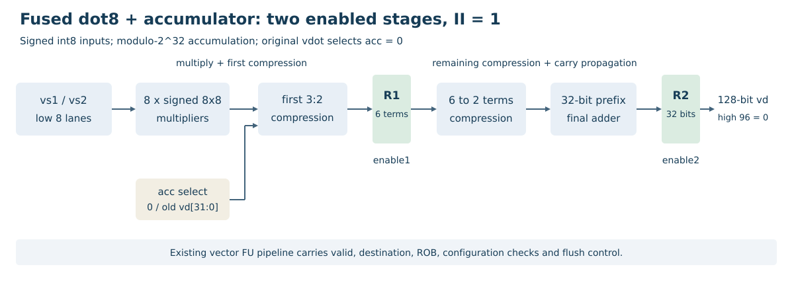
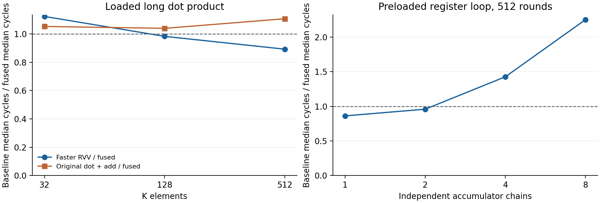

# 累加融合实验报告

香山昆明湖V2向量点积扩展。队伍：全栈漏洞队。参赛单位：西安电子科技大学。

## 一、设计目标与语义

在原有8项点积之外新增vdot.acc，保留原vdot的不累加语义。累加版将旧目标低32位作为真实输入，计算模2^32的融合累加，目标高96位清零。支持SEW=8、VLEN=128、LMUL=1、VL=8、vstart=0、vm=1；两源高64位不参与计算。

```text
partial = sum(signed8(vs1[i]) * signed8(vs2[i]), i=0..7)
vd.low32 = (old_vd.low32 + partial) mod 2^32
vd.high96 = 0
```

新编码mask/match为0xfc00707f/0x0400000b，内部操作类型0x101。译码保留第三源，并设置isDependOldVd，防止TA及完整覆盖条件误删真实累加依赖。操作数读取、ROB、有效位、写回、异常和冲刷沿用现有向量通路；与向量乘法共享执行位置。非法配置保持原目的和vstart，异常行为与原点积契约一致。

## 二、两级压缩重定时



8路乘法器由两种点积指令共用，普通vdot选择累加输入零。第一阶段完成乘法、符号扩展和第一层3:2压缩，寄存6项和/进位；第二阶段继续压缩至两项，经32位并行前缀加法寄存输出。各层按模2^32截断，不串接独立的最终累加加法器。

该结构在保持两个有效使能边沿延迟和一拍接收间隔的条件下，重新分配两级组合逻辑。四种累加Chisel结构及原模块测试均通过；完整原型/实际RTL黄金验证含12类定向、4096组随机及独立使能保持，每模型检查8217拍完整128位结果。

## 三、同约束资源与时序

固定Nangate45 typical、1.10 V、25°C，ABC目标1000 ps，每设计只映射一次，同一网表分别检查1/1.5/2.5 ns。输入/输出延迟100 ps，输入转换50 ps，输出负载5 fF，不确定度20 ps，理想时钟、零互连。综合包装器把两级使能绑定为公共enable，完整FU控制与端口未计入面积；独立使能由功能测试另行覆盖。

| 结构 | 面积，Liberty属性单位 | 1.5 ns建立裕量，ns |
|---|---:|---:|
| 原始不累加模块 | 4944.408 | +0.351741 |
| 平衡归约后串累加，单元输出 | 5431.188 | -0.561671 |
| CSA及普通最终加法，单元输出 | 5733.896 | -0.220036 |
| CSA及并行前缀，单元输出 | 5830.188 | -0.055645 |
| 提前压缩及前缀，单元输出 | 5608.344 | +0.100698 |
| 提前压缩及前缀，整核实际输出 | 5519.500 | +0.136429 |

前五项为同轮结构对照，最后一项另绑定整核firtool优化后的实际SV并通过同样黄金检查。整核实际算术模块较原模块增加11.631%映射面积，159个触发器；1 ns仍有负建立裕量。面积为Liberty属性单位；评估范围为理想时钟、零互连的算术模块。

同轮前缀结构在提前一级压缩后，面积由5830.188降至5608.344，减少3.805%；1.5 ns建立裕量由-0.055645 ns转为+0.100698 ns。改进来自两级组合逻辑重新分配，接收间隔仍为1拍。

## 四、整核功能与差分

整核与参考库从已提交源码构建，运行版本标志为dirty: 0。随机用例按全局序号分成16片，沿同一固定种子序列独立差分，合并后核对1006个序号。22318次合法点积覆盖1000组随机、6组定向、6种别名、TA/TU、正负溢出及源高位；每片另重复640条累加链和7种非法形式，重复项不增加唯一随机输入数量。非法配置检查目的及vstart保持，并核对各异常的预期mtval。额外1664条累加流水测试覆盖独立目的、vadd生产者、别名链及两个分支方向；v0/v31另有6形式、两种策略的整核差分。

原向量加法、点积smoke、寄存器及1664条流水四项回归均通过；标准向量乘法、归约与访存由本轮完整长点积的两条RVV路径覆盖。新增1000组随机同时覆盖原vdot对照，共2012次原指令执行。专用非零累加探针的正常结果为0x12345680，故障NEMU参考库给出0x12345681，真实Difftest报告v12_low差异；正常、故障、恢复原始退出码依次为0、1、0。提交记录确认新指令正常执行并参与向量状态比较。

交叉异常检查另覆盖原vdot与累加版各24种形式。旧参考在48例中有20例mtval错误，RTL差分检出首个差异；修正前置寄存器对齐及masked目的v0检查后，同一RTL与新参考48例全部通过，目标及vstart保持。修正参考另通过1000组固定随机输入的NEMU功能回归。整核随机及错误参考实验保留其初始参考库身份，完整性能采样使用修正参考；修正仅插入译码合法性检查，合法算术与晚期配置检查的源代码前后逐字节相同，两版参考分别保存摘要。

## 五、真实长点积

两源为相同连续int8数组，每条实现沿完整K维累加，末尾仅保存一次相同16字节结果。计时包含初始化、必要配置、全部加载、循环、跨块累加、末尾归并/归约、完整存储及结束fence；黄金计算在计时外。36个测量组分片运行，每组仍单独预热后重复5次，60条长点积及120条累加链样本均启用RTL/NEMU差分，组号无遗漏、无重复。测试程序每次检查完整128位和未用哨兵，紧凑日志保留每条链低32位及定向有序校验摘要，由Python独立重建核对；高位另外由程序检查及向量状态差分覆盖。下表为中位周期及范围，加速比分子取两条RVV候选较短的中位数。

| K | 原vdot+加法 | RVV8 | RVV16 | vdot.acc | 较快RVV/acc |
|---:|---|---|---|---|---:|
| 32 | 119（119-119） | 127（127-127） | 128（128-128） | 113（113-113） | 1.124 |
| 128 | 183（183-210） | 208（208-229） | 173（173-195） | 176（176-192） | 0.983 |
| 512 | 453（439-470） | 549（536-556） | 365（365-377） | 409（409-431） | 0.892 |

相对较快RVV的周期比为：K=32为1.124倍；K=128为0.983倍；K=512为0.892倍。相对原vdot+显式加法，三个K的周期比分别为1.053、1.040、1.108倍。融合路径在K=32的片段周期更短。K=128/512仍由较强RVV路径取得更短周期。

四路径每32项循环指令数为28、28、16、22。融合路径消除4条显式向量加法及两次循环内配置切换，保留四个独立累加器。各分片的同名内核函数入口PC相同；输入数组基址可不同，两个源之间的512字节间距及64字节对齐保持一致，各组独立预热。指令数减少不等同于周期同比下降；与较强RVV16的结果按实际数值判断。

## 六、单链与多链

固定相同预加载输入和非零累加初值，比较原vdot+显式e32加法及融合路径。1/2/4/8链、32/128/512轮、五次重复共120条样本，均检查每条链的完整128位结果及未使用位置的哨兵。下表为512轮中位周期；增量估计为(C512-C128)/(384×链数)，包含循环和调度成本，不能称裸FU延迟。

| 独立链数 | 原vdot+加法周期 | 融合周期 | 原路径/融合 | 融合增量周期/点积 |
|---:|---:|---:|---:|---:|
| 1 | 3137 | 3639 | 0.862 | 7.000 |
| 2 | 3490 | 3640 | 0.959 | 3.500 |
| 4 | 5201 | 3643 | 1.428 | 1.750 |
| 8 | 9814 | 4353 | 2.255 | 1.042 |

512轮单链的原路径/融合周期比为0.862倍，8条独立链为2.255倍。融合每轮消除对应链数的显式向量加法及两次配置切换；单链保留真实累加反馈，多链则提供相互独立的调度输入。周期比对应表中的完整程序片段。

原路径的点积不读取累加器，循环真实递推只经过显式vadd；融合路径的真实递推经过点积指令，两个程序的依赖图不同。实测单链融合更慢，8条独立链的融合片段更快。



## 七、复现与交付

源码含Chisel完整补丁、实际生成RTL、NEMU扩展、功能/性能程序、黄金模型和运行入口。原始日志、命令、反汇编、逐次CSV、工具与输入摘要随实验包保存。复现入口见[累加融合复现](累加融合复现.md)，逐次结果见[实验数据索引](data/acc-results/README.md)。

设计采用累加、压缩树和前缀加法。具体改动是昆明湖V2中的共享路径、两级组合逻辑分配和旧目标依赖处理；算术模块与整核程序片段分别测量。
