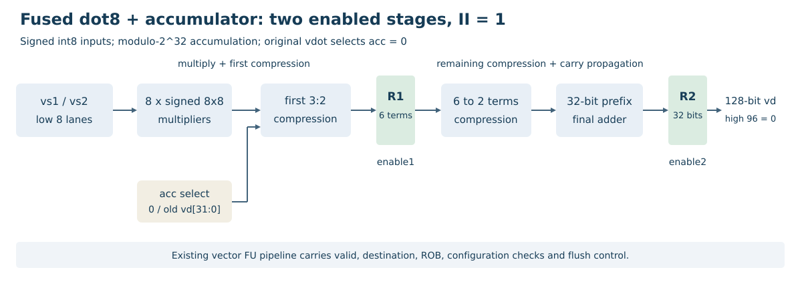
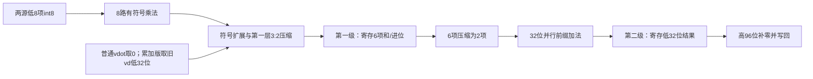

# 两级累加融合点积实验

本实验以已验收的vdot实现为基线，新增独立编码的vdot.acc。原vdot保持不读取旧目标，累加变体读取旧vd低32位；两者共用8路有符号8×8乘法器与结果路径。指令定义见[契约](累加指令契约.md)，测量边界见[性能方法](累加融合性能方法.md)。

## 数据通路

所有压缩和最终加法按模2^32运算。第一层压缩移至乘法级，以缩短第二级路径；使能仍由现有VecPipedFuncUnit提供。算术延迟为两个有效使能边沿，独立输入的目标接收间隔为1拍。有效位、ROB、目的寄存器标识、异常和冲刷沿用向量执行通路。

## 调度接入

新编码使用custom-0、funct6=000001、funct3=000，内部操作类型0x101。VecDecoder第三源为SrcType.vp，DecodeUnit对该指令设置isDependOldVd，防止TA或VL完整覆盖条件误删真实累加依赖。原vdot仍为SrcType.no。RiscvInst将两个编码均识别为向量算术，VIMacU以输入操作类型选择零或旧累加器，以输出操作类型选择完整结果及配置异常。

## 对照结构与验证

保留原点积、平衡树后加32位累加、进位保存压缩、前缀加法及提前压缩等隔离结构，使用同一Liberty库、ABC目标和1/1.5/2.5 ns STA约束比较。算术原型、黄金测试和综合入口见[实验目录](../experiments/acc/README.md)。比较范围为算术模块，不代表全核面积或频率。

实际Chisel入口为香山补丁中的VdotAccDatapath，独立测试为[datapath测试](../datapath/test/src/VdotAccDatapathTest.scala)。完整生成RTL、映射网表、原始命令和结构摘要分别绑定到对应实验回执。

| 实际算术模块 | 面积，Liberty属性单位 | 1.5 ns建立裕量，ns |
|---|---:|---:|
| 原始不累加点积 | 4944.408 | 0.351741 |
| 平衡归约后串32位累加 | 5431.188 | -0.561671 |
| 进位保存压缩，普通最终加法 | 5733.896 | -0.220036 |
| 进位保存压缩，最终并行前缀 | 5830.188 | -0.055645 |
| 提前一级压缩，最终并行前缀 | 5608.344 | 0.100698 |

以上来自同一轮、同库同约束对照。综合包装器将两个阶段使能绑定到公共enable，独立使能行为另由功能测试覆盖，完整FU控制逻辑未计入面积。提前压缩版较原始不累加点积增加13.428%映射面积，较未重定时前缀版减少3.805%，同时在1.5 ns建立约束下从负裕量转为正裕量；1 ns仍未通过。两级延迟与一拍接收间隔由数据通路测试检查，不以时序数值代替功能测试。详细原始证据见[数据索引](data/acc-ppa/README.md)。

整核firtool输出会进一步优化Verilog，不能将上述单元测试输出视为整核文件的逐字节副本。另对整核实际生成的VdotAccRetimedDatapath.sv执行同样黄金验证与PPA：面积5519.500，较原点积模块增加11.631%；1.5 ns建立裕量+0.136429 ns，1 ns仍为-0.363571 ns。两种生成形式分别保存摘要，整核结果见[实际模块数据](data/acc-ppa/full-core/results.json)。

[功能验证程序](../examples/acc_validation.c)覆盖非零累加、正负回绕、别名、TA/TU、源高位及非法形式；[性能程序](../examples/acc_benchmark.c)比较四种长点积实现与1/2/4/8条累加链。NEMU独立运行用于功能检查，其计数不作为RTL性能。只有真实RTL/NEMU运行的完整日志、GOOD TRAP、退出0和结果检查齐备时才记入整核验收。
